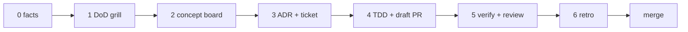

# skills

Personal agent skills, installable with the [skills CLI](https://github.com/vercel-labs/skills) and listed on [skills.sh](https://skills.sh).

## Install

```bash
# list what is in this repo
npx skills add PNNutkung/skills --list

# install everything for Claude Code, globally
npx skills add PNNutkung/skills --skill '*' -a claude-code -g

# or pick one
npx skills add PNNutkung/skills --skill zero-trust-review --skill mutation
npx skills add PNNutkung/skills --skill dev-workflow --skill definition-of-done --skill paired-agent-tdd --skill zero-trust-review --skill mutation --skill retro   # the whole workflow, step by step with a gate between steps
npx skills add PNNutkung/skills --skill definition-of-done   # its ADR (or export) feeds paired-agent-tdd and qa-sweep
npx skills add PNNutkung/skills --skill retro   # step 6: looks back at finished work, turns mistakes into ratchet rules
npx skills add PNNutkung/skills --skill paired-agent-tdd --skill zero-trust-review --skill mutation   # paired-agent-tdd borrows the probes (and optionally the sandbox runner) of zero-trust-review
npx skills add PNNutkung/skills --skill verify   # runs the DoD items and writes docs/verify/<slug>.md from the real runs; works alone or as dev-workflow step 5
npx skills add PNNutkung/skills --skill qa-sweep --skill zero-trust-review --skill mutation --skill paired-agent-tdd   # qa-sweep borrows the mutation probe of one and the direct runner of the other
mkdir -p ~/.claude/hooks && curl -fsSL -o ~/.claude/hooks/pr-test-tiers.py https://raw.githubusercontent.com/PNNutkung/skills/main/hooks/pr-test-tiers/pr-test-tiers.py   # qa-sweep reads test tiers through it ($TIERS_PY); registering it as a hook is optional
```

Claude Code only, to also get the `zero-trust-review` guard, the `qa-guard` hook, the telemetry-capture hook, the opt-in `paired-agent-tdd` file fence, the `dev-workflow` guard, the opt-in `definition-of-done` guard and its `dod-adr-sync` hook, the `verify-guard` hook, the `retro-collect` hook, the `reply-style` hook that puts [`rules/reply-style.md`](rules/reply-style.md) into each session, and the `ticket-why-guard` hook that denies a new issue or PR without the 4 sections ([ticket-writer](skills/ticket-writer/SKILL.md)) (skills alone do not include hooks; every switch is in [Flags](#flags)). While a `qa-sweep` run is open, `qa-guard` keeps that session to adding tests: it denies edits to product code, any change that removes or rewrites an existing test line, and `git commit` / `git push`, and every deny prints the command that ends the run.

```sh
/plugin marketplace add PNNutkung/skills
/plugin install pnnutkung-skills@pnnutkung-skills
```

Two standalone hooks that are not part of the plugin. Install steps are in each README.

- [`hooks/test-name-guard`](hooks/test-name-guard) keeps added tests named `should ... when ...` (Python and TypeScript/JavaScript): by default it warns at `git commit` and denies `gh pr create` / `glab mr create` until they are renamed.
- [`hooks/pr-test-tiers`](hooks/pr-test-tiers) denies `gh pr create` / `glab mr create` unless the branch ships unit, integration and e2e tests, with real dependencies in containers and a stated reason for any mock. It also denies a change request that deletes a test, or adds a skip or an expected-failure marker, without a stated reason. It only warns at `git commit` and reminds when a test file is created.

## Skills

| Skill | What it does |
| --- | --- |
| [`dev-workflow`](skills/dev-workflow) | The whole loop from idea to merge, in one order with a code gate between steps (`workflow.mjs next` refuses to move on without the step's evidence): facts and spike by a low-tier subagent before the first question, the `definition-of-done` grill (the verify environment booked there), one concept board with two or more design variants chosen in one round, the ADR and ticket written once, `paired-agent-tdd` and a draft PR, `docs/verify/<slug>.md` with real-run evidence for every DoD item (passing items are ticked on the ticket), an independent `zero-trust-review`, and the `retro` before merge. Small work may skip only the board, on the user's saved answer. The run folder lives in `~/.cache/dev-workflow`; `status` resumes from the repo when it is gone. The `workflow-guard` hook (on by default; `WORKFLOW_GUARD_ENABLED=false` turns it off) keeps product code untouched until the design is locked and blocks `gh pr merge` / `glab mr merge` until verify and retro are done. |
| [`definition-of-done`](skills/definition-of-done) | Step 1, before any code: grills the user in rounds (every question has a recommended answer) until nothing is left to assume, and writes `docs/dod/<slug>.json` + `.md` where every item quotes its source (a spec, the ticket or the user's answer). `dod.mjs check` refuses an unquoted item, an unaccepted assumption or an open question. Rewrites the linked ticket's description with the DoD as a checklist (official CLI first, then MCP, else a file to paste), only after the user approves the exact text, and records it as an ADR in the repo's ADR folder (each decision with its options, pros, cons and the trade-off accepted; only the ADR is committed) that `paired-agent-tdd` and `qa-sweep` read directly through `"dodFile"` or find by its `touches`, or exports it for them as before. ADR `touches` follow file moves through a pre-commit hook (`DOD_ADR_PRECOMMIT_HOOK_ENABLED=false`) and the `dod-adr-sync` hook (`DOD_ADR_TOUCHES_SYNC_ENABLED=false`). The opt-in `dod-guard` hook (`DOD_GUARD_ENABLED=true`) keeps product code untouched during the session. |
| [`paired-agent-tdd`](skills/paired-agent-tdd) | TDD as driver/navigator pairs, one pipeline per file group on a Workflow script (`graph.mjs`, `workflow.js`). Plain-code gates (`tdd.mjs`) run the tests (directly by default, in the sandbox with `plan.sandbox: true`), mutate the new code and check that tests cover the definition of done, so agents judge facts instead of claims. Every stage is a repair loop, not one shot: makers edit and re-run the real gate, navigators re-check on fresh facts, and the loop ends on a pass, on no progress, or at a round cap. `plan` proves the runner runs the repo's tests before an agent is paid (a broken environment never passes for a valid RED). One run-wide repair budget caps the spend; a group still failing is paused, and `tdd.mjs resume` writes a continue file from the gate files (no agent, no tokens) that holds a stalled group, stops a broken environment and sets the next budget, so the next run restarts only what is left. |
| [`zero-trust-review`](skills/zero-trust-review) | Strict review of a branch diff against a 30-point production-hazard checklist, tiered and cost-capped (`quick` / `standard` / `deep`, plus an opt-in `fast` for diffs that are not security-critical). Cites findings as permalinks on the review host (GitLab, GitHub, or git-only). |
| [`ai-code-delivery`](skills/ai-code-delivery) | Delivery runbook for agent-written code: feature-flag gating, trunk/leaf review depth, PR proof template, fresh-context review, 80/20 readiness gate, canary rollout. Hands the diff review to `zero-trust-review`. |
| [`qa-sweep`](skills/qa-sweep) | QA of a whole repo or one feature, no diff needed: a per-module inventory of unit, integration and e2e tests, or a feature deep-dive that derives cases from quoted requirements, proves weak tests and test gaps with mutants (`mutate.mjs`), and adds the regression tests that close them to the project's own suites. A behavior nobody wrote down becomes a question to the user. Every finding carries a proof that `findings.mjs` re-checks in plain code; what fails is reported as unverified. It only adds tests, never edits product code and never commits (the `qa-guard` hook enforces this). |
| [`verify`](skills/verify) | Proves a new feature, flag or config really works where the DoD says: the agent writes a plan (per DoD item: the booked env, a command and what to expect), and `verify.mjs` refuses a plan that misses an item, a booked env or a new flag, or has a weak expect; it fills the expect itself for `node --test`, pytest, vitest/jest and `go test` (no failures, at least one test, a passing test named with the item id). Then code runs every command, each new flag unset, flipped and invalid, reads `[ci]`-type envs from the PR's check runs through `gh` REST, takes another machine's output through `record` with its source named, and writes each item's section of `docs/verify/<slug>.md` from the real run (a failing item is written as `fail`, the rest still run). A rerun replaces only the sections that ran. With no ADR it lists what the branch adds and verifies only the claims the user confirms. It asks before running anything on the user's machine, adds no tests and never edits product code; the `verify-guard` hook (on by default; `VERIFY_GUARD_ENABLED=false`) holds the session to `docs/verify/` while a run is open. |
| [`retro`](skills/retro) | Step 6, after the work: a retrospective of a merged PR, a branch or the last N days, in any repo. Code collects the facts (git, PR comments and CI through `gh`, Claude Code transcripts with secrets redacted, guardrails, steering file sizes); every finding cites evidence that `retro.mjs check` re-checks and marks `passed`, `not-passed` or `no-evidence`; only proposals the user approves by id are applied (`applied-check` refuses any other change). A mechanical mistake becomes a ratchet rule: `.ratchet.json` counts violations per rule per file (ESLint, ruff or the skill's own patterns such as `as` casts and magic strings), a pre-commit hook and `ratchet.mjs check --ci` refuse any count that goes up and lock in any that goes down. A judgment call goes to the repo's standards file. Each retro appends one line to `docs/retro/log.md`. The `retro-collect` hook saves a session's numbers when a PR merges or the session ends (`RETRO_AUTO_COLLECT_ENABLED=false`). |
| [`ticket-writer`](skills/ticket-writer) | Writes a new issue, ticket or pull request body that starts with why the work exists and what result we expect: Why (the problem today, with evidence), Expected outcome (metric, today, target, or `not measurable: <reason>`), If we do nothing (the cost) and How we know (the check that proves it), in English or Thai headings (ADR 0012). `ticket.mjs issue-check` gates the body; `ticket.mjs template` prints the template. The `ticket-why-guard` hook (on by default; `TICKET_WHY_GUARD_ENABLED=false`) denies `gh`/`glab` issue and PR create and the GitHub/GitLab MCP create tools when a section is missing or the body cannot be read. `definition-of-done` and `dev-workflow` use its sections for the DoD ticket and the PR body. |
| [`branch-summary`](skills/branch-summary) | Summarizes every change on the current branch against its base (auto-detected, or passed as the argument): per-file analysis scaled to the branch size, test coverage and gaps, breaking changes, workaround detection and mermaid diagrams. Writes a self-contained HTML report to the OS temp directory, never into the repo. The report format is in `report-format.md`, read before the report is written; `build-report.mjs` refuses a report without its title, Summary and Test Coverage. |

`zero-trust-review` and `paired-agent-tdd` use the same model and effort tiering policy. See `skills/zero-trust-review/tiering.md` and the tiering section of `skills/paired-agent-tdd/SKILL.md`. `qa-sweep` follows it in one session: judgment stays in the session, mechanical steps may go to a low-tier subagent.

## How to use

Skills load by themselves when a prompt matches their description, or by name (`/dev-workflow`, `use the retro skill`). Each skill works on its own; `dev-workflow` only runs the others in order.

### Pick one skill

| You want to | Install | Say, for example |
| --- | --- | --- |
| Pin down what "done" means before coding | `definition-of-done` | `Grill me on this feature and write the DoD: <what you want>. Ticket: <link>` |
| Build a multi-file change test-first | `paired-agent-tdd` + `zero-trust-review` | `Build <feature> with paired-agent-tdd from the DoD in docs/adr/<file>.md` |
| Review a branch before merge | `zero-trust-review` | `Zero-trust review this branch` or `Grill this PR` (`quick`, `standard` or `deep`) |
| Find missing or weak tests, no diff needed | `qa-sweep` + `zero-trust-review` + `paired-agent-tdd` | `QA src/billing and add the regression tests it is missing` |
| See what a branch changed | `branch-summary` | `Summarize this branch` |
| Decide how to ship agent-written code | `ai-code-delivery` | `How should I flag, review and roll out this change?` |
| Look back on finished work | `retro` | `Retro of PR #42` or `Retro of the last 7 days` |

### The whole flow

Install all five with the "whole workflow" line in [Install](#install) (or the plugin, which adds the guard hook), then start it from the repo, on a new branch:

```text
Use dev-workflow for this: <what you want, in a few sentences>. Ticket: <link, if any>.
```

Add `This is speed work` when the goal is a number (time, size, memory): the run then measures first. It walks the steps below and stops at each gate until that step has its evidence. You answer questions in rounds (each with options A/B and a recommendation), choose a design on the concept board, and approve the ADR, the ticket text and each retro proposal. Nothing merges on its own.



- **Where am I:** `What step is the dev-workflow run on?` (`workflow.mjs status`). In a new session, or after the run folder is gone: `Resume the dev-workflow run for <slug>`; it picks up from the ADR, the PR, `docs/verify/<slug>.md` and the retro log.
- **Small change:** say `skip the board: <reason>` (for example `skip the board: one-line doc fix`) and the concept board is skipped. Only the board can be skipped; DoD, verify and retro always run.
- **The guard:** with the plugin installed, `workflow-guard` is on: while a run is open on the branch it denies product-code edits before the ADR and `gh pr merge` / `glab mr merge` before verify and retro. `WORKFLOW_GUARD_ENABLED=false` turns it off; with no open run it blocks nothing.

## Flags

Set flags in the shell or in `~/.claude/settings.json` under `env`. Each skill reads only its own flags. A flag means what it says, or nothing runs: a value outside the allowed list, or an old name that is still set, stops the tool with a message that names the fix. A hook denies every tool call it guards, a CLI exits 2 (the sandbox runner 64), and the pre-commit hook stops the commit. Unset or empty means the default.

| Flag | Values | Default | What it does |
|---|---|---|---|
| `REPLY_STYLE_ENABLED` | `true` \| `false` | `true` | reply-style hook (`hooks/reply-style.mjs`): at session start, resume, clear and compact, puts [`rules/reply-style.md`](rules/reply-style.md) into the session (technical terms in English with a short note in brackets, ASD-STE100 sentences); `false` adds nothing |
| `WORKFLOW_GUARD_ENABLED` | `true` \| `false` | `true` | dev-workflow guard (`hooks/workflow-guard.mjs`): while a run is open on the branch, no product code before the design is locked and no merge before verify and retro |
| `WORKFLOW_VERIFY_ENV_CHECK_ENABLED` | `true` \| `false` | `true` | dev-workflow verify gate: when the ADR's verify env books names (`[cloud] ...; [ci] ...`), each passing item's `env:` must start with one of them and every name needs a passing item; no names booked passes with a warning (ADR 0005) |
| `WORKFLOW_PR_WHY_CHECK_ENABLED` | `true` \| `false` | `true` | dev-workflow `next --pr`: the PR body (read through `gh`, or `--pr-body <file>`) must start with Why, Expected outcome, If we do nothing and How we know, each filled in, before the run moves from tdd to verify (ADR 0012) |
| `TICKET_WHY_GUARD_ENABLED` | `true` \| `false` | `true` | ticket-writer guard (`hooks/ticket-why-guard.mjs`): `gh issue create`, `gh pr create`, `glab issue create`, `glab mr create` and the GitHub/GitLab MCP create tools are denied when the body does not start with Why, Expected outcome, If we do nothing and How we know, or cannot be read (use `--body-file`) |
| `VERIFY_GUARD_ENABLED` | `true` \| `false` | `true` | verify guard (`hooks/verify-guard.mjs`): while a verify run is open in the session, no edit in the repo outside `docs/verify/`, no hand edit of a section `verify.mjs` wrote, and no Bash write, commit or push in the repo |
| `VERIFY_RUN_TIMEOUT_MAX` | a whole number above 0 \| `unlimited` | `unlimited` | most seconds one planned `verify.mjs run` command may take; a longer one is killed with its process group and written as `result: fail` (`timeout after Ns`) |
| `DOD_GUARD_ENABLED` | `true` \| `false` | `false` | definition-of-done guard (`hooks/dod-guard.mjs`): no product code and no unapproved ticket write while a DoD session is open |
| `DOD_ADR_PRECOMMIT_HOOK_ENABLED` | `true` \| `false` | `true` | `dod.mjs adr` installs the git pre-commit hook, and the hook makes ADR `touches` follow committed file moves |
| `DOD_ADR_TOUCHES_SYNC_ENABLED` | `true` \| `false` | `true` | `hooks/dod-adr-sync.mjs`: ADR `touches` follow the agent's `mv` and `git mv` |
| `DOD_QUESTIONS_CHECK_ENABLED` | `true` \| `false` | `true` | `dod.mjs check` also refuses a question in `questions.md` with fewer than two options or an option with no pro or no con (`dod.mjs questions` checks it alone), and, once a question is saved, an answer in `answers.md` whose question is not (`dod.mjs questions` too) |
| `DOD_TIME_FLOOR_CHECK_ENABLED` | `true` \| `false` | `true` | `dod.mjs check` also refuses an item with a wall-time target (`<= 80 s`) that has no measured `timeFloor` (user+sys CPU-seconds and cores), or whose largest target is below cpuSeconds / cores |
| `DOD_TICKET_WHY_ENABLED` | `true` \| `false` | `true` | `dod.mjs check` requires `why`, `outcomes` (metric, today, target, proven by; or not measurable with an accepted answer) and `costOfInaction` in a DoD session this version opened; `render`, `ticket-check` and `adr` put Why, Expected outcome, If we do nothing and How we know first; `render --pr` writes them for the PR body (ADR 0012); `false` = as before |
| `PTDD_GUARD_ENABLED` | `true` \| `false` | `false` | paired-agent-tdd file fence (`hooks/ptdd-guard.mjs`): each subagent edits only its group's files |
| `PTDD_ADR_AUTO_FIND_ENABLED` | `true` \| `false` | `true` | with neither `dod[]` nor `dodFile` in `plan.json`, use the ADR whose `touches` cover the groups' `src` |
| `PTDD_AGENT_MAX` | a whole number above 0 \| `unlimited` | `unlimited` | most agents one paired-agent-tdd run may start |
| `PTDD_PIPELINE_MODE` | `fast` \| `paired` | `fast` | `fast`: a group with no `after` gets one tdd-driver and one navigator; `paired`: separate RED and GREEN pairs (the v2.0.0 pipeline); `plan.mode` overrides it |
| `PTDD_QUICK_DRIVER_GATE_ENABLED` | `true` \| `false` | `true` | a driver's middle GREEN gate run skips mutation; its first and last runs and the navigator's run keep it |
| `PTDD_GATE_REUSE_ENABLED` | `true` \| `false` | `true` | a navigator, and `verify`, reuse a gate result when a sha256 of the snapshot, the group's files and the gate's arguments matches (the flake check still re-runs) |
| `PTDD_COURIER_SKIP_ENABLED` | `true` \| `false` | `true` | no final courier when every fixer reports its gate ok; `tdd.mjs verify` is the check |
| `PTDD_PARALLEL_REVIEW_ENABLED` | `true` \| `false` | `true` | the integration-tester and the reviewer run at the same time; the integration test is still gated but not read by the reviewer |
| `PTDD_INPROCESS_RUNNER_ENABLED` | `true` \| `false` | `true` | the built-in `direct-run.mjs` runs each test command inside `tdd.mjs` (and inside the `testprobe.mjs` and `mutate.mjs` it starts: `--runner-inprocess`), not as a node process per command; the same exit codes, ledger lines and `ZT-RUN` line; no effect with `--runner` set to another file or `plan.sandbox`; `false` starts `direct-run.mjs` per command as before |
| `PTDD_MUTATION_SCORE_MIN` | a whole number from `0` to `100` | `100` | the mutation score (killed + timeout of all mutants not marked equivalent) the GREEN and final gates of paired-agent-tdd need; a surviving mutant fails whatever it says, so `0` is the behavior before ADR 0011; above `0`, a changed code file no mutator covers (`.sh` ...) needs a user answer id in `plan.mutation.accept` |
| `PTDD_MUTATION_MAX` | a whole number above 0 \| `unlimited` | `unlimited` | most mutants the final gate runs over every changed line (GREEN keeps its sample of 12); no time budget at final |
| `PTDD_TEST_WRITER_ENABLED` | `true` \| `false` | `true` | fast mode: a test-writer agent writes each group's tests from the DoD and the ADR `## Interface` section, a code-driver writes the code and sends a `testWrong` note instead of editing a test, a judge marks final-gate survivors equivalent; `plan` then needs `dodFile` with an Interface section, and `green --retest` is refused (`red --rewrite` re-baselines RED); `false`: one tdd-driver per group |
| `QA_ADR_AUTO_FIND_ENABLED` | `true` \| `false` | `true` | with neither `requirements` nor `dodFile` in `findings.json`, use the ADR whose `touches` cover the files the findings name |
| `RETRO_RATCHET_PRECOMMIT_HOOK_ENABLED` | `true` \| `false` | `true` | `ratchet.mjs install` adds the git pre-commit hook, and the hook refuses a count in `.ratchet.json` that went up |
| `RETRO_TRANSCRIPTS_ENABLED` | `true` \| `false` | `true` | retro reads Claude Code session transcripts (redacted) |
| `RETRO_AUTO_COLLECT_ENABLED` | `true` \| `false` | `true` | `hooks/retro-collect.mjs` saves a session's numbers after a PR merge and at session end, and reminds about `/retro` |
| `RETRO_UNENFORCED_RULE_CHECK_ENABLED` | `true` \| `false` | `true` | `retro.mjs check` marks a finding whose `rule` was hit on an earlier branch (`docs/retro/rule-hits.json`) or cites 2+ evidence items as a repeat, and fails when a repeat of a `partial` or `judgment` rule has no proposal with `level` or `noLevel` (ADR 0013) |
| `RETRO_STEERING_BYTES_MAX` | a whole number above 0 \| `unlimited` | `8000` | a CLAUDE.md or AGENTS.md larger than this is a retro finding |
| `BRANCH_SUMMARY_FORMAT_CHECK_ENABLED` | `true` \| `false` | `true` | `build-report.mjs` refuses a branch-summary report without its `#` title, `## Summary` and `## Test Coverage` (the small-change fast path needs only the title and its `**Branch**:` line), names `report-format.md` and writes no HTML |
| `ZT_POST_GUARD_ENABLED` | `true` \| `false` | `false` | zero-trust-review posts nothing to the review host until the user approves |
| `ZT_SELF_REVIEW_GUARD_ENABLED` | `true` \| `false` | `false` | the author of a change never posts its review verdict, and a defender answers each confirmed finding (blue/red) |
| `ZT_AGENT_MAX` | a whole number above 0 \| `unlimited` | `unlimited` | most agents one zero-trust-review run may start |
| `ZT_MUTATION_BASELINE_REUSE_ENABLED` | `true` \| `false` | `true` | `mutate.mjs --baseline-from` reuses the unmutated HEAD run that `testprobe.mjs --head-out` wrote, only when it is from the same tree, command and environment, instead of running its own baseline; inside paired-agent-tdd it rarely fires, because a same-tree gate is already reused whole |
| `ZT_MUTATION_BUDGET_STRICT_ENABLED` | `true` \| `false` | `true` | when the `mutate.mjs` budget runs out, mutants already running are stopped too (process trees killed, reported `skipped`), not only those not yet started |
| `ZT_TEST_PROCESS_MAX` | a whole number above 0 \| `unlimited` | `unlimited` | most test commands one gate runs at once: a `testprobe.mjs` or `mutate.mjs` run, or one paired-agent-tdd gate as a whole (`red`, `green` with its test probe, mutation probe and coverage, `final`); `green` splits the cap between its probes, or runs them one after the other when it is too small to split |
| `ZT_SANDBOX_MODE` | `auto` \| `none` \| `seatbelt` \| `bwrap` \| `docker` | `auto` | which sandbox `sandbox-run.mjs` uses: `auto` takes the first that works, a name forces that one (or exit 86), `none` pretends there is none |
| `CHECKS_TEST_CONCURRENCY_MAX` | a whole number above 0 | cores + 1 | `rules/checks/run-tests.mjs`: most test files `node --test` runs at once (`--test-concurrency`); a `--test-concurrency` you pass wins |
| `CHECKS_TEST_FILE_SECONDS_MAX` | a whole number above 0 \| `unlimited` | `30` | `rules/checks/test-time.mjs` (CI, node 24 on Ubuntu): most seconds one test file may take |
| `CHECKS_TEST_FILE_WARN_SECONDS_MAX` | a whole number above 0 \| `unlimited` | `20` | `rules/checks/test-time.mjs`: a test file slower than this gets a warning (a `::warning` annotation in CI); the exit code does not change |
| `CHECKS_TEST_SUITE_SECONDS_MAX` | a whole number above 0 \| `unlimited` | `120` | `rules/checks/test-time.mjs` (CI, node 24 on Ubuntu): most seconds the whole suite may take |
| `CHECKS_TEST_SUITE_WARN_SECONDS_MAX` | a whole number above 0 \| `unlimited` | `100` | `rules/checks/test-time.mjs`: a suite slower than this gets a warning (a `::warning` annotation in CI); the exit code does not change |

`true`, `false`, `unlimited` and mode names are read in any case. Old names stop the tool until they are unset: `DOD_GUARD`, `PTDD_GUARD`, `PTDD_AGENT_CAP`, `ZT_POST_GUARD`, `ZT_SELF_REVIEW_GUARD`, `ZT_AGENT_CAP`, `ZT_SANDBOX_FORCE`.

## Requirements

- macOS or Linux. On Windows, run the skills and hooks inside WSL; native Windows is not supported yet (the scripts call `tar`, `sh` and Unix process groups, and the sandbox has no Windows backend).
- Node 22+ (`graph.mjs`, workflow tests, `sandbox-run.mjs`, `testprobe.mjs`) and Python 3 (`triage.py`).
- `zero-trust-review` states no guess as a fact: findings quote real code, claims carry a proof (code `file:line`, a sandbox run, or real logs/metrics/traces), and `proofcheck.mjs` re-verifies them in plain code. It runs change-request code only inside a sandbox (macOS `sandbox-exec`, Linux `bwrap`, or docker via `ZT_SANDBOX_IMAGE`); with none, probes report `unverifiable` and never run bare.
- `zero-trust-review` works on any git repo. To read change-request metadata and post comments it uses the host CLI: [`glab`](https://gitlab.com/gitlab-org/cli) for GitLab or [`gh`](https://cli.github.com) for GitHub (per-host commands in `skills/zero-trust-review/hosts.md`); without one it runs git-only and writes the report only. Its Step 0 reads the skill location from `SK` (default `~/.claude/skills/zero-trust-review`); set `SK` if the CLI installed it elsewhere.
- `dev-workflow` needs Node 22+ and git, and the skills it hands steps to (`definition-of-done`, `paired-agent-tdd`, `zero-trust-review`, `retro`). With `definition-of-done` installed next to it, the DoD gate runs its `dod.mjs check`; otherwise it reads the DoD JSON. It finds the pull request with `gh api` when `gh` is installed, else from `next --pr`.
- `definition-of-done` needs Node 22+ and git. It writes the ticket with an official CLI (`gh`, `glab`, `acli`) when one is on PATH, a third-party one (`jira`, `linear`) only after you trust it on that machine (`dod.mjs trust`, kept in `~/.config/definition-of-done`), otherwise an MCP connector, otherwise it leaves `docs/dod/<slug>.ticket.md` for you to paste.
- `retro` needs Node 22+ and git. It reads PR comments and checks with `gh` (or `glab`) when installed, and counts ESLint and ruff rules with the repo's own ESLint (`node_modules/.bin` first) and ruff; a missing linter is a warning locally and a failure in CI. Transcripts are read from `~/.claude/projects` (`CLAUDE_CONFIG_DIR` moves it).
- `branch-summary` needs Node 22+ to build its HTML report (`build-report.mjs`); the report page loads `marked`, `DOMPurify` and `mermaid` from a CDN.
- `paired-agent-tdd` needs the Workflow tool (per-node model, effort and agent type), git, Node 22+ and the sibling `zero-trust-review` skill (its mutation probe, `proofcheck.mjs` and, only with `plan.sandbox: true`, its sandbox runner; `ZT_DIR` points elsewhere).
- `qa-sweep` needs Node 22+, Python 3, git and two sibling skills: `zero-trust-review` (its mutation probe, run folder and, only when asked, its sandbox runner; `ZT_DIR` points elsewhere) and `paired-agent-tdd` (its `direct-run.mjs`; `PTDD_DIR` points elsewhere). Its repo inventory, tier lists and test-file checks use `hooks/pr-test-tiers/pr-test-tiers.py` (`TIERS_PY` points at it; default `~/.claude/hooks/pr-test-tiers.py`). It runs tests directly, with your rights and network, and runs e2e tests only against a local app unless you confirm the exact URL in that run. The `qa-guard` hook comes with the plugin install.

## Tests

```bash
node rules/checks/run-tests.mjs
```

It runs every tracked `*.test.mjs` with `node --test`, the slowest files first (by `rules/checks/test-times.json`) and cores + 1 files at once ([rules/performance.md](rules/performance.md)); other arguments go to `node --test` (`--test-reporter=dot`, or test files to run only those). CI runs the same command on every pull request (adding a timings reporter, `rules/checks/test-time.mjs`, whose time caps the node 24 Ubuntu job enforces): Node 22, 24 and 26 (the three newest LTS majors) on Ubuntu and macOS, Node 24 from asdf shims, and Node 24 in WSL on Windows. Sandbox tests run through sandbox-exec on macOS and bwrap on Linux, and skip where neither is installed.

## Telemetry

The skills CLI sends anonymous install telemetry, which is how skills.sh builds its leaderboard. Set `DISABLE_TELEMETRY=1` to opt out.
