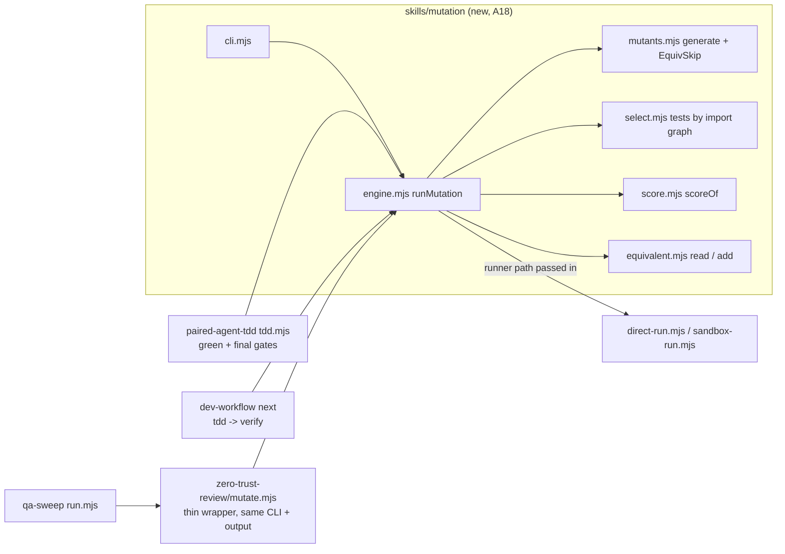

---
touches:
  - "skills/mutation/**"
  - "skills/paired-agent-tdd/**"
  - "skills/zero-trust-review/mutate.mjs"
  - "skills/zero-trust-review/mutants.mjs"
  - "skills/zero-trust-review/probelib.mjs"
  - "skills/zero-trust-review/*.test.mjs"
  - "skills/dev-workflow/**"
  - "skills/definition-of-done/**"
  - "README.md"
  - "docs/**"
  - ".claude-plugin/*.json"
  - "rules/checks/flag-defaults-e2e.mjs"
  - "skills/qa-sweep/run.mjs"
dod: mutation-gate
---
# 11. Mutation gate

Date: 2026-11-26
Status: Accepted

## Context

Nut asked: "จะรู้ได้ยังไงว่า TDD ที่ agent เขียนมัน expect cover ทุก case ที่อาจจะเกิด bug ได้" and then "อยากให้บังคับเลย" (make it mandatory).

Mutation testing is the most direct measure: the tool changes the code one line at a time and checks that some test fails. Before this decision (main 1e7c8a5) it was enforced only in part:

- ptdd's GREEN gate failed on a surviving mutant, but skipped, timed-out and inconclusive mutants passed, so a gate could pass with 0 killed.
- The agent could write `mutation.off` in its own plan.
- Files the mutator cannot change (`.sh`, other languages) passed silently.
- Only 12 mutants per group were sampled. On merged commit 18cfe66 the sample found 4 survivors; every changed line found 70 of 323 (score 78 %, 281 s on 4 cores). On bd2f7b5 the sample found 0 of 2.
- Fast mode, the default, let one agent write both the tests and the code.
- TDD done in the session under dev-workflow had no mutation check.
- The engine lived inside zero-trust-review, while ptdd and qa-sweep also called it.

Nut weighted correct code with few bugs above speed (A7).

## Decision

### A1: What counts as a passing mutation result?

Context: today only survivors fail; skipped (budget), timeout and inconclusive mutants pass, so a gate can pass with 0 killed (tdd.mjs:269-277, mutate.mjs:69)
Options considered (the agent's analysis when the question was asked):
- (A) score = (killed + timeout) / all sampled mutants; skipped and inconclusive count as not killed; pass when score >= PTDD_MUTATION_SCORE_MIN (default 100)
  - pro: one number, strict; 100 keeps today's no-survivor rule and closes the skipped hole
  - con: budget-skipped mutants now fail: needs more time or CPU per gate
- (B) keep 0 survivors and allow up to 20% skipped or inconclusive
  - pro: fewer new fails
  - con: two rules to read; a slow suite can still hide gaps
- (C) Stryker-style threshold, default 80%, survivors allowed below it
  - pro: familiar number
  - con: weaker than today (survivors pass): not backwards compatible in spirit
Recommended: A
Answer: A (score = (killed + timeout) / all sampled mutants; skipped and inconclusive count as not killed; pass when score >= PTDD_MUTATION_SCORE_MIN (default 100))
Trade-off accepted: budget-skipped mutants now fail: needs more time or CPU per gate

### A2: Where is it enforced?

Context: ptdd green gate already mutates; dev-workflow's in-session TDD and no-Workflow path only advise mutate.mjs (dev-workflow/SKILL.md:77); the verify skill is being built in another thread
Options considered (the agent's analysis when the question was asked):
- (A) ptdd green gate plus dev-workflow: next from tdd needs a mutation result for the changed sources with score >= min, whichever way TDD ran; verify only shows the score
  - pro: no path skips it, even TDD in this session
  - con: one more file to produce on the in-session path
- (B) ptdd only
  - pro: smallest change
  - con: in-session TDD stays unchecked
- (C) A plus the verify skill re-runs mutation
  - pro: double check
  - con: duplicate runs; touches the other thread's files
Recommended: A
Answer: A (ptdd green gate plus dev-workflow: next from tdd needs a mutation result for the changed sources with score >= min, whichever way TDD ran; verify only shows the score)
Trade-off accepted: one more file to produce on the in-session path

### A3: What happens to plan.mutation.off?

Context: the agent writes the plan, so today the agent can switch mutation off itself (tdd.mjs:262)
Options considered (the agent's analysis when the question was asked):
- (A) off needs an answer id from the user (mutation: {off: "A9"}); without one plan stops
  - pro: only the user can switch it off, and it is recorded
  - con: old plans with plain off stop with an error
- (B) remove off; only the env flag can disable mutation
  - pro: simplest rule
  - con: no per-run exception for a legit case
- (C) keep as is
  - pro: no change
  - con: the agent can still skip it
Recommended: A
Answer: A (off needs an answer id from the user (mutation: {off: "A9"}); without one plan stops)
Trade-off accepted: old plans with plain off stop with an error

### A4: What about sources with no mutator (.sh, .yaml, unsupported languages)?

Context: they get 0 mutants and the gate stays ok (mutate.mjs:132)
Options considered (the agent's analysis when the question was asked):
- (A) code files with 0 mutants make green not ok unless the user accepted it by answer id; config and data files in src stay exempt
  - pro: no silent pass for a language the tool cannot mutate
  - con: shell-heavy changes need one answer
- (B) warn only
  - pro: no new stops
  - con: the gap stays silent in practice
Recommended: A
Answer: A (code files with 0 mutants make green not ok unless the user accepted it by answer id; config and data files in src stay exempt)
Trade-off accepted: shell-heavy changes need one answer

### A5: Which mutation tool?

Context: zero-trust-review mutants.mjs is built in, line-level, no dependencies, covers py, js/ts, c-like (SKILL.md:38)
Options considered (the agent's analysis when the question was asked):
- (A) keep the built-in mutator for everything
  - pro: no install, same on CI and every machine
  - con: simpler operators than Stryker or mutmut
- (B) Stryker for JS/TS and mutmut for Python when installed, built-in otherwise
  - pro: richer operators, known scores
  - con: two more tools, slower, different numbers by machine
- (C) built-in now, B as a follow-up issue
  - pro: ship the gate fast, decide tools with data
  - con: two steps
Recommended: C
Answer: C (built-in now, B as a follow-up issue)
Trade-off accepted: two steps

### A6: How many mutants per group?

Context: default max 12 sampled, budget 60 s, sized for the navigator's ~180 s turn limit (tdd.mjs:55); Nut prefers full CPU when it lowers wall time
Options considered (the agent's analysis when the question was asked):
- (A) every changed line: PTDD_MUTATION_MAX default unlimited, all cores, in green
  - pro: no sampling gaps
  - con: large groups can hit the turn limit and fail as skipped
- (B) keep 12, PTDD_MUTATION_MAX to raise it
  - pro: no speed change
  - con: sampling can miss lines
- (C) 12 in each green, every changed line once in the final gate (PTDD_MUTATION_MAX default unlimited there)
  - pro: full coverage once, fast loops; I measure final's time in the prototype
  - con: a gap found late costs one more repair round
Recommended: C
Answer: C (12 in each green, every changed line once in the final gate (PTDD_MUTATION_MAX default unlimited there))
Trade-off accepted: a gap found late costs one more repair round

### A7: How is the test writer kept independent from the code writer?

Context: default mode fast: one driver writes tests and code (SKILL.md:75); paired has separate drivers but was made non-default for speed in PR #22
Options considered (the agent's analysis when the question was asked):
- (A) make paired the default again
  - pro: already built and tested
  - con: undoes the PR #22 speed gain
- (B) fast keeps one pipeline, but its tests come from a separate test-writer agent that sees the DoD and interfaces only, not the src files; then the driver writes code
  - pro: independence with most of fast's speed
  - con: a new role and gate to build
- (C) keep fast, require paired only for groups the DoD marks security-critical
  - pro: no cost for normal work
  - con: most code still self-tested
Recommended: B
Answer: B; Nut: focus on correct code with few bugs over speed of work
Trade-off accepted: none recorded (the answer picks no single option)

### A8: In fast mode with a separate test writer (A7 B), who may change a test after RED?

Context: today the frozen check blocks test edits after RED; only `green --retest` re-baselines, and the fast driver can call it (probes.md:139). Nut: correct code with few bugs is worth more than speed (A7)
Options considered (the agent's analysis when the question was asked):
- (A) only the test writer: the code driver sends a "test is wrong" note with a reason; the test writer fixes or rejects it, then RED runs again
  - pro: the code author can never weaken a test
  - con: one more agent turn when a test is really wrong
- (B) the code driver may run green --retest as today
  - pro: fastest
  - con: the author can still bend a test to fit the code
Recommended: A
Answer: A (only the test writer: the code driver sends a "test is wrong" note with a reason; the test writer fixes or rejects it, then RED runs again)
Trade-off accepted: one more agent turn when a test is really wrong

### A9: What does the test writer see?

Context: classic TDD: the tests define the new interface; the base code exists, the new code does not yet
Options considered (the agent's analysis when the question was asked):
- (A) the DoD, the plan's file list and the base code; the tests define the new API, the code driver must match it
  - pro: true test-first, no code to copy from
  - con: the test writer must design the API names
- (B) the code driver writes empty stubs first (names, types, no logic); the test writer reads stubs and DoD
  - pro: API comes from the code author
  - con: the code author shapes what is tested; one more step
Recommended: A
Answer: A; Nut: API names should come from the grill and DoD; asks whether to add an API step to the grill, since Nut reviews the architecture with details and a diagram before work starts
Trade-off accepted: none recorded (the answer picks no single option)

### A10: Does the full mutation run in the final gate (A6 C) have a time limit?

Context: green keeps 12 mutants and a 60 s budget (tdd.mjs:55); the final gate has no mutation today (tdd.mjs:421)
Options considered (the agent's analysis when the question was asked):
- (A) no time limit by default: every mutant runs; PTDD_MUTATION_MAX (default unlimited) caps the count if a user wants
  - pro: no mutant is skipped, so A1 never fails on time alone
  - con: a large change makes final slow
- (B) a budget, default 600 s; mutants left over count as not killed (A1)
  - pro: bounded time
  - con: big changes fail on time, not on a real gap
Recommended: A
Answer: A; Nut: find ways to make it faster
Trade-off accepted: none recorded (the answer picks no single option)

### A11: How does dev-workflow check mutation when TDD ran outside ptdd (A2 A)?

Context: no dev-workflow code reads mutation today (dev-workflow/*.mjs)
Options considered (the agent's analysis when the question was asked):
- (A) workflow.mjs next runs mutate.mjs itself on the branch's changed sources and changed tests, and stores the result in the run folder
  - pro: code runs it, the agent cannot type a score
  - con: next from tdd takes longer
- (B) the agent runs mutate.mjs and saves the JSON; next reads and checks it
  - pro: next stays fast
  - con: the agent picks the files and the command
Recommended: A
Answer: A (workflow.mjs next runs mutate.mjs itself on the branch's changed sources and changed tests, and stores the result in the run folder)
Trade-off accepted: next from tdd takes longer

### A12: Flag names (each skill owns its own flags)

Context: rules: _ENABLED true|false, _MAX number|unlimited, invalid value = hard error, new flags default on (memory flag-naming)
Options considered (the agent's analysis when the question was asked):
- (A) PTDD_MUTATION_SCORE_MIN=100 (0-100), PTDD_MUTATION_MAX=unlimited (final gate count), PTDD_TEST_WRITER_ENABLED=true, WORKFLOW_MUTATION_CHECK_ENABLED=true, WORKFLOW_MUTATION_SCORE_MIN=100
  - pro: each part can be tuned or switched off alone; all off = today
  - con: five new flags in the README table
- (B) only PTDD_MUTATION_GATE_ENABLED and WORKFLOW_MUTATION_CHECK_ENABLED; score fixed at 100, count unlimited
  - pro: two flags, simple
  - con: no way to tune the threshold for a slow repo
Recommended: A
Answer: A (PTDD_MUTATION_SCORE_MIN=100 (0-100), PTDD_MUTATION_MAX=unlimited (final gate count), PTDD_TEST_WRITER_ENABLED=true, WORKFLOW_MUTATION_CHECK_ENABLED=true, WORKFLOW_MUTATION_SCORE_MIN=100)
Trade-off accepted: five new flags in the README table

### A13: Where is the new API (names, inputs, outputs, errors) decided, so the test writer can use it (A9)?

Context: Nut reviews the architecture with details and a diagram before work starts (step 3 design); the DoD says what done means, not the API shape
Options considered (the agent's analysis when the question was asked):
- (A) the design step: the chosen variant writes an Interface section (names, inputs, outputs, errors) and a diagram into the ADR; Nut approves it; the test writer reads that section; ptdd plan stops in test-writer mode when the ADR has no Interface section
  - pro: one place, reviewed by Nut with the diagram; no extra grill round
  - con: the ADR template gets one more section
- (B) the grill: API names are grill questions and DoD items
  - pro: named before any design
  - con: the API is fixed before variants are compared
- (C) the test writer decides the API alone
  - pro: no new step
  - con: Nut sees the API only in the PR
Recommended: A
Answer: A (the design step: the chosen variant writes an Interface section (names, inputs, outputs, errors) and a diagram into the ADR; Nut approves it; the test writer reads that section; ptdd plan stops in test-writer mode when the ADR has no Interface section)
Trade-off accepted: the ADR template gets one more section

### A14: Verify env, test tiers, touched files, non-goals?

Context: required DoD sections not yet asked; ptdd needs the Workflow tool for a real agent run, which this cloud session does not have (dev-workflow SKILL.md:77); vreal kit exists for real A/B runs (skills/paired-agent-tdd/vreal/)
Options considered (the agent's analysis when the question was asked):
- (A) [cloud] fixture repos: ptdd gates with each new flag unset/true/false/invalid, a surviving mutant blocks and a killed one passes, dev-workflow next blocks then passes; dogfood: this branch's own next runs the mutation check; [ci] CI green. Tiers unit, fuzz, integration, e2e. Non-goals: Stryker/mutmut (follow-up issue, A5), verify skill files, qa-sweep, Windows
  - pro: all checks run here and on CI
  - con: the test-writer prompt is checked by the dry-run plan only, not by a real agent run
- (B) A plus one real ptdd run with agents on the vreal kit on your machine ([nut-wsl]), test-writer on
  - pro: proves the new role works with real agents
  - con: needs your machine and costs agent tokens
Recommended: B
Answer: B (A plus one real ptdd run with agents on the vreal kit on your machine ([nut-wsl]), test-writer on)
Trade-off accepted: needs your machine and costs agent tokens

### A15: Approve the DoD (15 items, dod.mjs check ok)?

Context: dod.md in project files; Q10 split into FinalNoLimit and FinalSpeed; RealRun added from A14
Options considered (the agent's analysis when the question was asked):
- (A) approve; go to the concept board and measure the full final mutation time
  - pro: work goes on now
  - con: a later DoD change needs a new check and approval
- (B) change items first
  - pro: DoD matches before work starts
  - con: one more round
Recommended: A
Answer: A (approve; go to the concept board and measure the full final mutation time)
Trade-off accepted: a later DoD change needs a new check and approval

### A16: How are equivalent mutants handled (a mutant no input can tell from the original)?

Context: measure.md: merged commit 18cfe66 has 70 survivors of 323 (78%); some are equivalent, e.g. regex [a-z0-9] -> [a-z0-10] (check.mjs:100); with PTDD_MUTATION_SCORE_MIN=100 (A1) an equivalent mutant can never be killed
Options considered (the agent's analysis when the question was asked):
- (A) a separate judge agent (not the code driver, not the test writer) may mark a survivor equivalent with a written reason; marked mutants leave the score; the list goes into the PR body and the final gate report for Nut to read
  - pro: keeps 100 reachable without lowering the bar
  - pro: the author cannot excuse its own gap
  - con: an agent judgement; Nut reads the list in the PR
- (B) each equivalent survivor needs Nut's answer id, like mutation.off (A3)
  - pro: only Nut decides
  - con: many questions on a large change
- (C) also teach the mutator to skip known-equivalent patterns (regex digit ranges ...), plus A
  - pro: fewer equivalent mutants to judge at all
  - con: mutator change in zero-trust-review; the pattern list needs care
Recommended: C
Answer: C (also teach the mutator to skip known-equivalent patterns (regex digit ranges ...), plus A)
Trade-off accepted: mutator change in zero-trust-review; the pattern list needs care

### A17: Concept board: where do the mutation engine and the score live?

Context: board.json in project files; ptdd imports zero-trust-review probes already (tdd.mjs:33); dev-workflow imports neither today
Options considered (the agent's analysis when the question was asked):
- (A) engine and score in zero-trust-review mutate.mjs (every-line mode, import test selection, all cores, kill reuse, equivalent skip, --equivalent, --score-min); ptdd and dev-workflow pass their own flag values
  - pro: one code path, same number everywhere; speed work helps zero-trust-review too
  - con: mutate.mjs grows; more zero-trust-review tests
- (B) engine in zero-trust-review, a score function in each skill
  - pro: each skill owns its whole policy
  - con: two score functions can drift
- (C) ptdd owns the gate; dev-workflow calls tdd.mjs mutation
  - pro: reuses ptdd runner and cache
  - con: dev-workflow depends on ptdd and needs a plan.json for in-session TDD
Recommended: A
Answer: D; Nut's words: "Q17 แยก mutation engine ออกมาเป็น module ตัวเองไหม? ไม่ว่า skill ไหนก็สามารถเรียกใช้งานได้" (variant D added to the board for this; form chosen in A18)
Trade-off accepted: none recorded (the answer picks no single option)

### A18: Nut asked for the mutation engine as its own module any skill can call (variant D of Q17). What form?

Context: today mutate.mjs + mutants.mjs live in zero-trust-review and use its probelib.mjs (228 lines: git extract, process pool, runner); callers: zero-trust-review, ptdd tdd.mjs, qa-sweep run.mjs, and dev-workflow after this work; ptdd finds siblings by path with ZT_DIR (tdd.mjs:33)
Options considered (the agent's analysis when the question was asked):
- (A) a new skill folder skills/mutation/ with a short SKILL.md (an agent can also call it alone: "mutation-test my change"); it holds the engine, the mutators, the score and the equivalent file; the runner is passed in (--runner), so the sandbox stays in zero-trust-review; zero-trust-review/mutate.mjs stays as a thin wrapper with the same CLI and output; the engine reads no env flags, each caller reads its own flags and passes options; MUTATION_DIR overrides the path like ZT_DIR
  - pro: one engine for 4 callers; discoverable like the other skills
  - pro: old commands, old ZT_MUTATION_* flags and old output keep working
  - con: the shared helpers in probelib.mjs move or are split: a larger diff
- (B) a plain library folder lib/mutation/ at the repo root, no SKILL.md
  - pro: smallest surface, only code
  - con: an agent cannot find or call it as a skill; a skill copied alone loses it
- (C) keep Q17 A: engine inside zero-trust-review, other skills import it from there
  - pro: no move
  - con: the engine belongs to the review skill, not to a shared module
Recommended: A
Answer: A (a new skill folder skills/mutation/ with a short SKILL.md (an agent can also call it alone: "mutation-test my change"); it holds the engine, the mutators, the score and the equivalent file; the runner is passed in (--runner), so the sandbox stays in zero-trust-review; zero-trust-review/mutate.mjs stays as a thin wrapper with the same CLI and output; the engine reads no env flags, each caller reads its own flags and passes options; MUTATION_DIR overrides the path like ZT_DIR)
Trade-off accepted: the shared helpers in probelib.mjs move or are split: a larger diff

### A19: Approve the ADR 0011 Interface section and diagram (A13) before TDD starts?

Context: docs/adr/0011-mutation-gate.md, adr-check ok; main is now 04c59a8 (plugin 2.9.0, last ADR 0010, no open PRs), so this work takes ADR 0011 and plugin 2.10.0; no linked ticket to rewrite
Options considered (the agent's analysis when the question was asked):
- (A) approve: commit the ADR, close the DoD session, start TDD (tests written by a subagent that sees only the ADR, then code)
  - pro: work starts now; the API is fixed for the test writer
  - con: a later API change needs an ADR edit and a new approval
- (B) change parts first (name the section)
  - pro: the API matches what you want before tests exist
  - con: one more round
Recommended: A
Answer: A (approve: commit the ADR, close the DoD session, start TDD (tests written by a subagent that sees only the ADR, then code))
Trade-off accepted: a later API change needs an ADR edit and a new approval

### A20: The Q16 example ([a-z0-9] -> [a-z0-10]) is not equivalent (digits 2-9 stop matching). What happens to EquivSkip?

Context: checked with node; the EquivSkip DoD item and the ADR use this example; measure.md corrected
Options considered (the agent's analysis when the question was asked):
- (A) drop EquivSkip; the judge agent (EquivJudge) handles every equivalent mutant
  - pro: no rule can skip a mutant that is a real test gap
  - con: the judge decides every one
- (B) keep the skip mechanism with an empty list; a pattern joins only with a test that proves it equivalent
  - pro: matches Q16 C; patterns can be added later safely
  - con: today no pattern lowers the judge's work
Recommended: B
Answer: B (keep the skip mechanism with an empty list; a pattern joins only with a test that proves it equivalent)
Trade-off accepted: today no pattern lowers the judge's work

### A21: Which tests does the gate run for each mutant?

Context: dogfood on this branch: score 46.65% (216 killed / 463); 91 survivors in proc.mjs, code moved from zero-trust-review whose old tests were not changed, so the gate (changed tests only) did not run them
Options considered (the agent's analysis when the question was asked):
- (A) the changed tests and every existing test file that imports a changed source (select.mjs import graph)
  - pro: moved or lightly edited code is killed by its existing tests; no duplicate tests
  - con: each mutant runs more tests, so slower
- (B) only the changed tests, as the ADR says now
  - pro: fast
  - con: code that only moved needs new tests although old tests cover it
Recommended: A
Answer: A (the changed tests and every existing test file that imports a changed source (select.mjs import graph))
Trade-off accepted: each mutant runs more tests, so slower

## Interface

Approved by Nut before TDD (A13). Diagram:

### skills/mutation (new skill folder)

- `engine.mjs`: `runMutation(opts) -> Promise<Result>`. No env reads: every switch is an option.
  - `opts`: `repo`, `head`, `base` (or `files`), `tests` (string[]), `cmd` (with `{file}`), `runner` (path), `scratch`, `max` (number or `"unlimited"`, default `"unlimited"`), `budget` (seconds or `"none"`, default `"none"`), `jobs` (default `os.availableParallelism()`), `timeout`, `killExits`, `link`, `ro`, `env`, `baselineFrom`, `budgetStrict`, `slots`, `select` (`"imports"` default, or `"all"`), `reuse` (paths of earlier Result files), `equivalent` (path), `scoreMin` (0-100, default 100), `signal`.
  - `Result`: `{available, mutants[], score, pass, reason?, tests: {run, notUsable}}`. A mutant: `{id, file, line, op, before, after, result, by?, run?, quote?, reused?, reason?}`, `result` one of `killed | survived | timeout | inconclusive | skipped | unverifiable | equivalent`.
  - Errors: a usage error throws `UsageError` (CLI exit 2); a run result is data (exit 0), never a throw.
- `score.mjs`: `scoreOf(mutants, {min}) -> {value, pass, counted, equivalent}`. `value = 100 * (killed + timeout) / (total - equivalent)`; skipped, inconclusive and unverifiable count as not killed (A1). `counted = 0` gives `value: null, pass: false`.
- `equivalent.mjs`: file `mutation-equivalent.json` = `{"schema": 1, "marks": [{"id", "file", "line", "reason", "judge"}]}`. `addMarks(path, marks, result)` refuses an id that is not a survivor of `result` and a reason under 20 characters. A mark applies only while the mutant id (a hash of file, line and edit) is the same.
- `select.mjs`: `testsFor(file, tests, repo) -> string[]`: the test files whose static `import`/`require` graph reaches `file`; a language without a graph gets every test. A file in the graph with a dynamic `import()` whose path is not a string literal (for example `MUTATION_DIR` lookups) counts as reaching every file, so the test is kept: an unknown edge never drops a test. A test file also reaches `file` when its text (or the text of a file in its graph) names `file`'s base name in a string literal, because a test that runs a CLI as a child process (`spawn(join(HERE, 'cli.mjs'))`) has no import edge to it. A killed mutant still stops at the first failing test file.
- Test set (A21): every gate passes `tests` = the changed test files plus every existing test file in the repo whose import graph reaches a changed source; `select` then narrows it per mutant.
- `mutants.mjs`: moved from zero-trust-review. EquivSkip (A20): `EQUIV_SKIP` is a list of known-equivalent patterns that `generateMutants` does not emit; it starts empty. An entry is `{op, line: RegExp, reason}`: a mutant is not emitted when its `op` equals `op` and `line` matches the original line. `generateMutants(path, text, lines, {perLine, skip = EQUIV_SKIP})` takes the list as an option. `mask(line, lang)` is exported for tests: it returns a string of the same length with comments as spaces and string contents as filler. A pattern joins the list only in the same commit as a test that proves its edit matches the same inputs as the original.
- `proc.mjs`: the git, tree and process helpers that `probelib.mjs` held (`gitOut`, `changes`, `extract`, `runIn`, `pool`, `shq`, `isSource`, `TEST`, `DOC`); `isSource` is false for test-support files under a `fixtures/` folder, as for tests; `backendOf(runner, env, {inprocess, timeout = CHECK_TIMEOUT_MS})` with `CHECK_TIMEOUT_MS = 15000`; `probelib.mjs` re-exports them, so zero-trust-review's other tools do not change.
- `cli.mjs`: `node cli.mjs --repo . --base REV --head REV --cmd '...' --runner PATH [--tests ...] [--max N|unlimited] [--score-min N] [--equivalent FILE] [--reuse FILE]...` prints the Result as JSON.
- `SKILL.md`: when to call it alone ("mutation-test my change"), the options, and the equivalent-file rule. `MUTATION_DIR` overrides the folder, like `ZT_DIR`.

### zero-trust-review

- `mutate.mjs` keeps its CLI, its exit codes, its `summary`, `score` and `mutants` keys and its flags `ZT_MUTATION_BASELINE_REUSE_ENABLED`, `ZT_MUTATION_BUDGET_STRICT_ENABLED`, `ZT_TEST_PROCESS_MAX`. It reads those flags and calls `runMutation` with today's defaults (`max 30`, `budget 600`, `jobs 4`). New output keys are additive only.

### paired-agent-tdd

- Flags: `PTDD_MUTATION_SCORE_MIN` (0-100, default 100), `PTDD_MUTATION_MAX` (number or `unlimited`, default `unlimited`), `PTDD_TEST_WRITER_ENABLED` (`true|false`, default `true`).
- `plan`: `mutation.off` must be an answer id string (`{off: "A9"}`); `true` stops with "mutation.off needs a user answer id: {off: \"A9\"}". `mutation.accept: {"<file>": "A<n>"}` exempts a code file with 0 mutants (NoMutants). With the test writer on, `plan` stops when the ADR (`dodFile`) has no `## Interface` section.
- `green`: 12 sampled mutants as today; ok needs `pass` at `PTDD_MUTATION_SCORE_MIN` and no unexempted code file with 0 mutants.
- `final`: `runMutation` over every changed line, `max = PTDD_MUTATION_MAX`, no budget, `reuse` = the green gate results (a mutant killed there on the same bytes is not run again), `equivalent = RUN/mutation-equivalent.json`. Final ok needs `pass`. It starts beside the reviewer, not after it.
- Agents (fast mode, test writer on): `test-writer` (writes the group's tests; sees DoD, plan file list, base code, ADR Interface), `code-driver` (writes code; returns `testWrong: [{test, reason}]` instead of editing a test), `judge` (no Edit or Write; marks survivors equivalent with a reason, via `tdd.mjs equivalent --add`). A `testWrong` note goes back to the test writer, which fixes or rejects it, then RED runs again (`red --rewrite`). `green --retest` is refused in this mode.
- Clarified in TDD (phase 2):
  - Survivors: a surviving mutant still fails green and final, as on main, whatever `PTDD_MUTATION_SCORE_MIN` says; the score min only decides how many skipped, inconclusive and unverifiable mutants a gate may have. So `PTDD_MUTATION_SCORE_MIN=0` gives main's behaviour.
  - Code file (NoMutants): a source file (`isSource`) whose extension is not a data or config one (`.json .yaml .yml .toml .ini .cfg .conf .txt .md .csv .lock .env .xml .html .css .svg`). The 0-mutant check applies only while `PTDD_MUTATION_SCORE_MIN` is above 0.
  - Interface stop: only in fast mode with the test writer on (paired mode has no test writer). The plan must name the ADR with `dodFile`; an inline `dod[]` plan stops and names the fix (`dodFile` or `PTDD_TEST_WRITER_ENABLED=false`). A `## Interface` heading with no text under it counts as missing. `plan` exits 2 for this stop, for a plain `mutation.off` and for a bad flag value.
  - Flags are read by every command from its own environment, as the other ptdd flags are.
  - Returns: the code driver returns `{done, testWrong: [{test, reason}]}`; the test writer returns `{done, rejected: [{test, reason}]}` for notes it does not accept (the code driver then gets the reason).
  - Judge: runs after a not-ok final that has survivors; it marks with `tdd.mjs equivalent --run RUN --add <id> --reason <text>`, checked against the last final result (else green); a refusal exits 1 with the equivalent.mjs message. Final then runs again with the marks; unmarked survivors go back to the test writer.
  - `red --rewrite` re-baselines RED after the test writer changed tests; it works with the test writer off too.
- Known limit: the gate cannot prove which agent ran a command; the role prompts, the frozen-test check and the judge's missing Edit tool are the guard.

### dev-workflow

- Flags: `WORKFLOW_MUTATION_CHECK_ENABLED` (`true|false`, default `true`), `WORKFLOW_MUTATION_SCORE_MIN` (0-100, default 100).
- `next` from `tdd`: runs `runMutation` on the branch's changed source files against the merge base, with the A21 test set, with the test command given once by `next --test-cmd '...'` and kept in the run; writes `RUN/mutation.json`; refuses with the survivor list when `pass` is false. It reads ptdd's equivalent file when present, else `RUN/mutation-equivalent.json`.
- Step 3 (lock) tells the agent to write `## Interface` with a diagram into the ADR; `dod.mjs adr` writes an empty `## Interface` heading for it.

### All flags off

`PTDD_MUTATION_SCORE_MIN=0`, `PTDD_TEST_WRITER_ENABLED=false`, `WORKFLOW_MUTATION_CHECK_ENABLED=false`, `PTDD_MUTATION_MAX=12`: the gates act as on main, except plain `mutation.off`, which errors (A3). Surviving mutants fail as on main; skipped, inconclusive and 0-mutant files pass as on main.

## Consequences

Trade-offs we accepted:

- A1: budget-skipped mutants now fail: needs more time or CPU per gate
- A2: one more file to produce on the in-session path
- A3: old plans with plain off stop with an error
- A4: shell-heavy changes need one answer
- A5: two steps
- A6: a gap found late costs one more repair round
- A8: one more agent turn when a test is really wrong
- A11: next from tdd takes longer
- A12: five new flags in the README table
- A13: the ADR template gets one more section
- A14: needs your machine and costs agent tokens
- A15: a later DoD change needs a new check and approval
- A16: mutator change in zero-trust-review; the pattern list needs care
- A18: the shared helpers in probelib.mjs move or are split: a larger diff
- A19: a later API change needs an ADR edit and a new approval
- A20: today no pattern lowers the judge's work
- A21: each mutant runs more tests, so slower

## Definition of done

<!-- dod: written by dod.mjs adr; do not edit; sha256:9521024610ac919b -->

- [ ] Score (happy, fail, edge): ptdd green gate: score = (killed + timeout) / all sampled mutants, skipped and inconclusive count as not killed; green is ok only when score >= PTDD_MUTATION_SCORE_MIN (default 100) (A1)
- [ ] WorkflowGate (happy, fail, edge): dev-workflow: next from the tdd step needs a mutation result with score >= WORKFLOW_MUTATION_SCORE_MIN, however TDD ran (A2)
- [ ] WorkflowRuns (happy, fail, edge): workflow.mjs next runs runMutation itself on the branch's changed sources and stores the result in the run folder; the agent never supplies the score (A11)
- [ ] TestSelect (happy, fail, edge): every gate (ptdd green and final, dev-workflow next) runs, for each mutant, the changed tests plus every existing test file whose import graph reaches the mutated source (select.mjs) (A21)
- [ ] OffByAnswer (happy, fail, edge): plan.mutation.off is accepted only with a user answer id (mutation: {off: "A9"}); plain off makes plan stop with an error naming the new form (A3)
- [ ] NoMutants (happy, fail, edge): a changed code file that gets 0 mutants makes green not ok unless the plan names a user answer id for it; config and data files in src stay exempt (A4)
- [ ] ToolsIssue (happy, fail, edge): a GitHub issue is opened for Stryker (JS/TS) and mutmut (Python) as optional mutators; this work keeps the built-in mutator (A5)
- [ ] FinalFull (happy, fail, edge): the final gate mutates every changed line once (green keeps 12 sampled); PTDD_MUTATION_MAX (default unlimited) caps the count (A6)
- [ ] FinalNoLimit (happy, fail, edge): the final gate's full mutation run has no time limit by default, so no mutant is skipped for time (A10)
- [ ] FinalSpeed (happy, fail, edge): the full final run is made faster without skipping mutants; each speed step is measured before and after (A10)
- [ ] TestWriter (happy, fail, edge): fast mode with PTDD_TEST_WRITER_ENABLED=true: a test-writer agent writes the group's tests (RED) before a code driver writes the code (A7)
- [ ] TestsOwned (happy, fail, edge): after RED only the test writer edits tests: the code driver sends a 'test is wrong' note with a reason, the test writer fixes or rejects it and RED runs again; the code driver cannot run green --retest (A8)
- [ ] WriterSees (happy, fail, edge): the test writer gets the DoD, the plan's file list, the base code and the ADR Interface section; never the code driver's new source (A9)
- [ ] Interface (happy, fail, edge): the design step writes an Interface section (names, inputs, outputs, errors) and a diagram into the ADR for the user to approve; ptdd plan stops in test-writer mode when the ADR has no Interface section (A13)
- [ ] Flags (happy, fail, edge): five flags: PTDD_MUTATION_SCORE_MIN=100 (0-100), PTDD_MUTATION_MAX=unlimited, PTDD_TEST_WRITER_ENABLED=true, WORKFLOW_MUTATION_CHECK_ENABLED=true, WORKFLOW_MUTATION_SCORE_MIN=100; an invalid value is a hard error; README Flags rows (A12)
- [ ] RealRun (happy, fail, edge): one real ptdd run with agents on the vreal kit on Nut's machine with the test writer on: the run finishes and its gates pass (A14)
- [ ] EquivJudge (happy, fail, edge): a judge agent that is neither the code driver nor the test writer may mark a surviving mutant equivalent with a written reason; marked mutants leave the score; the list is in the PR body and the final gate report (A16)
- [ ] EquivSkip (happy, fail, edge): the mutator keeps a skip mechanism for known-equivalent patterns, and the pattern list starts empty; a pattern joins the list only together with a test that proves its edit matches the same inputs (A20)
- [ ] Module (happy, fail, edge): the mutation engine, mutators, score and equivalent-file reader live in a new skill folder skills/mutation/ with a short SKILL.md; the runner is passed in; the engine reads no env flags (each caller passes options); zero-trust-review/mutate.mjs stays a thin wrapper with the same CLI, output and ZT_MUTATION_* flags; MUTATION_DIR overrides the path (A18)

- feature flag: PTDD_MUTATION_SCORE_MIN=0-100 default 100; PTDD_MUTATION_MAX=<n>|unlimited default unlimited; PTDD_TEST_WRITER_ENABLED=true|false default true; WORKFLOW_MUTATION_CHECK_ENABLED=true|false default true; WORKFLOW_MUTATION_SCORE_MIN=0-100 default 100; invalid value = hard error (A12)
- backward compat: every part can be switched off by its flag; with them off the gates act as today except plain mutation.off, which now errors and names the answer-id form (A3); next free plugin minor (A12)
- non-goals: Stryker/mutmut integration (follow-up issue), verify skill files, qa-sweep, native Windows (A14)
- verify env: [cloud] fixture repos: flags unset/true/false/invalid, survivor blocks, killed passes, dev-workflow next blocks then passes, dogfood on this branch; [ci] CI green; [nut-wsl] one real ptdd run on the vreal kit with the test writer on (A14)
- test tiers: unit, fuzz, integration, e2e (A14)
