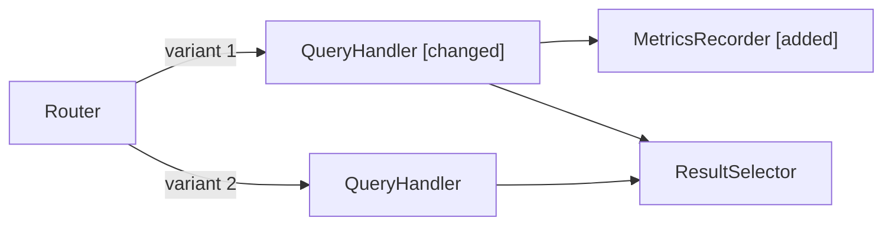
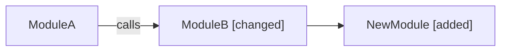
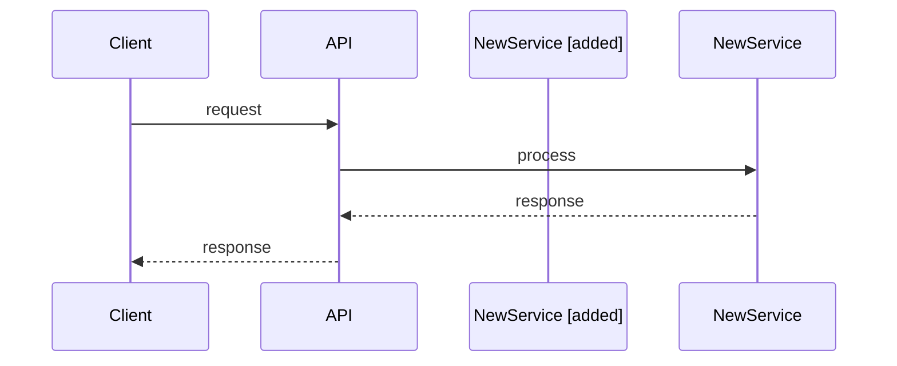
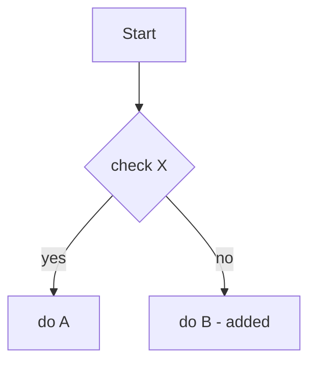
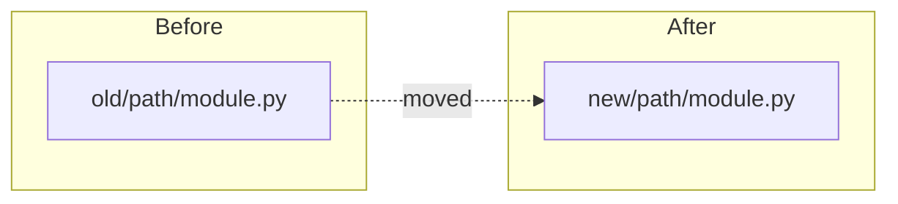

Summarize all code changes on the current git branch compared to the base branch.

If an argument was passed (it follows this text as `ARGUMENTS:`), use it as the base branch (validate first, then skip auto-detection).
Otherwise, auto-detect the base branch using the fallback chain below.

---

## Section 0 -- Pre-flight Checks

Before any analysis, validate the environment:

1. **Verify git repository**: Run `git rev-parse --is-inside-work-tree` via the Bash tool. If it fails, stop and inform the user: "This directory is not a git repository."

2. **Detect the current branch**: Run `git branch --show-current` via the Bash tool.
   - If the output is **empty**, the repo is in detached HEAD state. Stop and inform the user: "You are in detached HEAD state. Check out a branch first."
   - If the branch is `master` or `main`, stop and inform the user: "You are on the base branch. Switch to a feature branch first."

3. **Detect the base branch**:
   - If an argument is provided: validate it by running `git rev-parse --verify origin/<argument>` or `git rev-parse --verify <argument>` via the Bash tool. If neither resolves, stop and inform the user: "Branch `<argument>` not found. Check the branch name and try again." If valid, use it as the base and skip the fallback chain below.
   - Try `git rev-parse --verify origin/master` -- if it exists, use `master`.
   - Else try `git rev-parse --verify origin/main` -- if it exists, use `main`.
   - Else try `git rev-parse --verify origin/develop` -- if it exists, use `develop`.
   - If none exist, use the AskUserQuestion tool to ask the user to specify the base branch.
   - (Avoids `git remote show origin` which requires network access.)

4. **Check for shallow clone**: Run `git rev-parse --is-shallow-repository` via the Bash tool. If `true`, warn the user: "This is a shallow clone. Running `git fetch --deepen=100` to get enough history for accurate analysis." Run the deepen command via Bash. If `git merge-base` still fails after deepening, fall back to `git log --oneline -30` for recent history only and note that the analysis may be incomplete.

5. **Check for stacked branches**: Run `git rev-parse --abbrev-ref @{upstream} 2>/dev/null` via the Bash tool. If the upstream exists and is neither `master`, `main`, `develop`, `origin/master`, `origin/main`, nor `origin/develop`, warn the user: "This branch tracks `<upstream>` -- not master/main/develop. The diff may include changes from the parent branch. Specify a base branch if needed."

If any pre-flight check fails with a stop condition, do not proceed to subsequent sections.

---

## Section 1 -- Setup and Context Gathering

1. **Read project context first**: Use the Read tool to read `README.md` and `CLAUDE.md` (if they exist at the repo root) to understand architecture, module descriptions, naming conventions, and key patterns. This context is critical for accurate "Why" and "Impact" analysis later.

2. **Check merge base freshness**: Run `git merge-base <base> HEAD` and `git log --oneline <merge-base>..<base> | head -5` via the Bash tool. If the base has advanced significantly (10+ commits ahead), warn the user that the branch may need a rebase for an accurate diff.

3. **Check for uncommitted changes**: Run `git status --short` via the Bash tool. If there are staged or unstaged changes, warn the user: "You have uncommitted changes that will NOT be included in this summary. Commit or stash them first if you want them included." List the affected files.

4. Run `git diff <base>...HEAD --stat -M` and `git diff <base>...HEAD --name-status -M` via the Bash tool to get the file-level change summary with rename detection and clean file statuses (A/D/M/R) for classification in Section 2.

5. **Check for empty diff**: If `--stat` output is empty (no files listed), stop and inform the user: "No changes found between this branch and `<base>`. The branch may already be merged or is identical to the base." Do not proceed.

6. Run `git log <base>..HEAD --oneline --no-merges` via the Bash tool for commit history.

7. **Collect quick stats**: Parse `--stat` summary line for files changed. Count commits from step 6. Use these internally to determine the analysis tier in Section 2. Insertion/deletion totals from `--shortstat` may also be parsed *for the small-change fast path trigger only* (step 9), but must never be surfaced in the report.

8. Read branch name to infer intent (e.g., `fix/`, `hotfix/`, `workaround/`, `hack/`).

9. **Small change fast path**: If the `--stat` shows 3 or fewer files and roughly 50 or fewer lines changed, skip the full template and use this condensed format instead:

```
# <title>
**Branch**: ... | **Base**: ... | **Files**: N

<one paragraph explaining what changed and why>

**Files**: list each file with a one-line description of the change

(single mermaid diagram only if the change is structural, otherwise omit)

**Workarounds**: (any detected, or omit section entirely)
```

For the fast path: read each changed file's diff directly via the Bash tool, infer "Why" from commit messages and code comments only (skip structural inference and surrounding context), check for workaround markers in the diff, and skip backward compatibility detection and diagrams unless the change is obviously structural.

---

## Section 2 -- Change Analysis

### Tiered analysis based on branch size

Use the `--stat` file count to determine analysis depth:

- **1--30 files**: Full per-file analysis (read each file diff individually).
- **31--80 files**: Analyze top 30 files by change size in detail; summarize remaining files by directory with one-line descriptions.
- **>80 files**: Directory-level summary only; detail the top 15 most-changed files. Warn user: "This branch is very large (N files). Showing directory-level summary with detail on the 15 most significant files."

### Large diff strategy

Do NOT run `git diff <base>...HEAD` for the full diff upfront. Instead:

1. Use the `--stat` output from Section 1 to identify changed files.
2. For each changed file (within the tier limit), use the Read tool to read the relevant sections, or run `git diff <base>...HEAD -- <file>` via the Bash tool for individual file diffs.
3. If a single file diff is very large (500+ lines), focus on function/class signatures and key logic changes rather than line-by-line analysis.
4. **Use parallel tool calls** when analyzing independent files or modules -- do not process files sequentially if they have no dependency on each other's analysis. For branches with 10+ changed files, use the Agent tool with `subagent_type=Explore` to parallelize file analysis across subagents. Each subagent analyzes a module group independently.

### Handling new, deleted, renamed, binary, generated, and non-code files

- **Renamed/moved files**: The `--stat -M` output shows `old_path => new_path`. Treat these as moves, not add+delete. Note the rename and only analyze content changes (if any) within the file.

- **New files** (added on the branch): There is no "before" to diff. Use the Read tool to read the full file and summarize its purpose, public API, and how it integrates with existing code. If the new file exceeds 500 lines, read only the first 200 lines plus class/function signatures (use the Grep tool to find `def`, `class`, `function`, `export` declaration patterns). Summarize structure rather than reading line-by-line.

- **Deleted files**: The file no longer exists on disk. Use `git show <base>:<file>` via the Bash tool to retrieve the original content and explain why it was removed (merged elsewhere, obsolete, replaced by another file). If the deleted file exceeds 500 lines, read only the first 100 lines and any class/function signatures to understand its purpose. Focus on explaining why it was removed, not documenting its full contents.

- **Binary files and lock files** (images, compiled assets, `package-lock.json`, `poetry.lock`, `*.pyc`): Do not attempt to read or diff these. Simply note that they changed and, for lock files, mention whether dependencies were added or removed based on the corresponding manifest file (e.g., `requirements.txt`, `package.json`).

- **Generated/vendored code**: Detect by path patterns (`*_generated.*`, `*_pb2.py`, `*_pb2_grpc.py`, `vendor/`, `__snapshots__/`, `*.gen.go`, `*.gen.ts`, `node_modules/`). Treat like binary files: note that they changed, identify the source (e.g., "regenerated from `*.proto`"), skip detailed analysis.

- **Submodule changes**: `--stat` shows these as `Subproject commit` lines. Note the submodule name and the old/new commit SHAs. Do not attempt to read or diff submodule contents. Summarize as: "`<submodule>` updated from `<old-sha>` to `<new-sha>`".

- **Non-code files** (config, YAML, Dockerfile, requirements.txt, CI files, documentation): Group these separately as "Configuration and Documentation" rather than forcing them into module groups. Apply a lighter analysis: what changed, why, and any risk (e.g., new dependency version, changed environment variable, loosened security config).

### Reading surrounding context

When the diff alone is not enough to understand "why", read the unchanged surrounding code:

- The full function or class a change sits inside (use the Read tool).
- Callers or importers of a modified function (use the Grep tool to find references).
- Related config, constants, or type definitions.
- **Bound context exploration**: Read at most 3 levels of callers/references per changed function. Do not recursively explore the entire call graph.

### Inferring "Why" -- priority order

1. **Commit messages** -- the author's own words; most reliable signal. Check these first.
2. **PR/MR description** -- if the branch name references a ticket (e.g., `PROJ-123`), note the ticket ID for the user to cross-reference.
3. **Code comments** -- inline comments near the change, especially `# reason:`, `# because`, `# workaround`.
4. **Structural inference** -- deduce from the diff pattern (e.g., adding a parameter everywhere suggests a new cross-cutting concern). Use this only when 1-3 provide no clear answer, and mark it as inferred: "[inferred from diff pattern]".
5. **Unknown** -- if all of the above fail, write: "Reason not determined from available context." Do not fabricate a rationale.

### Grouping and analysis

1. Classify each changed file into one of: implementation, test, config/docs, dependency manifest, binary/lock/submodule, generated/vendored.

2. Implementation changes are folded directly into **Test Coverage** (which references the implementation each test exercises), **Breaking Changes** (when detected — see backward-compatibility section below), and **Workaround Analysis**. Per-module write-ups are no longer produced.

3. **Separate test changes** into a dedicated "Test Coverage" group.

4. **Separate config/docs changes** into a dedicated "Configuration and Documentation" group.

5. **Separate dependency manifest changes** into a dedicated "Dependencies" group.

6. **Binary/lock/submodule/generated files**: list them with a one-line note; no detailed analysis.

7. For the test group, produce:
   - **Tests added/modified**: list of test functions/classes.
   - **What they cover**: which implementation changes each test validates.
   - **Coverage gaps**: any implementation changes that lack corresponding tests. **Parallel-structure check**: if this diff applies the same edit shape to 2+ sibling files (e.g. an identical new field + override added to two similar schema/model classes), verify each sibling has equivalent test coverage — not just one. This only needs to check siblings that changed within this same diff; no codebase-wide search required.

8. For the config/docs group, produce:
   - **What changed**: file-level summary.
   - **Why**: rationale for the config or doc change.
   - **Risk**: any operational risk (new env var required, dependency version bump, CI behavior change). **Inert-config check**: if this diff introduces a new config key/flag with a no-op default (e.g. `None`/`False`/disabled), grep the repo for that key's name outside the file that defines it. State explicitly whether any other file actually assigns it a real activating value, or whether this diff alone is a no-op until a separate deploy-config change sets it.

### Backward compatibility / breaking change detection

For each implementation module, explicitly check for these signals and flag any found:

- **Function/method signature changes**: added required parameters, removed parameters, changed return type.
- **Renamed or removed public exports**: classes, functions, constants that other modules import.
- **API response shape changes**: added/removed/renamed fields in response models.
- **Database schema changes**: new required columns, dropped columns, altered types. Detect via migration files, ALTER TABLE statements in diffs, or ORM model field changes.
- **Behavioral changes**: altered default values, changed error types raised, modified control flow that callers depend on.

If any breaking changes are found, list them in the dedicated `## Breaking Changes` section of the output template. If none are found, omit that section entirely (per the section omission rule).

### Language awareness

This skill is language-agnostic. Adapt analysis patterns to the project's language:

- Use the file extensions and project context (from `README.md`/`CLAUDE.md`) to determine the language.
- Adjust terminology accordingly (e.g., "interfaces" for TypeScript, "Pydantic models" for Python, "structs" for Go).
- Adjust comment syntax recognition (e.g., `#` for Python/Ruby, `//` for JS/TS/Go/Java, `--` for SQL).
- For infrastructure code (Terraform, Kubernetes manifests, CI configs), check for breaking changes by looking at removed resources, changed names/labels, and altered port/volume mappings.

---

## Section 3 -- Mermaid Diagram Generation

Generate **up to 5 diagrams** depending on what the diff touches:

| Diagram Type | When to Generate | Mermaid Type |
|---|---|---|
| Architecture | Changes touch 2+ modules or add/remove components | `flowchart` or `graph` |
| Data / Control Flow | Changes affect request handling, event flow, or pipelines | `sequenceDiagram` |
| Data Models | Changes to Pydantic models, dataclasses, ORM models, or schemas | `erDiagram` or `classDiagram` |
| Decision Paths | Changes introduce branching logic, error handling, or conditional flows | `flowchart` with branching |
| Structure Refactor | Changes are primarily file moves, renames, or restructuring with no new functionality | `flowchart` showing before/after file organization |

### Rules for diagram generation

- Only generate diagrams relevant to the actual changes (skip if not applicable).
- **Before/after annotations**: Use annotations to distinguish changes within a single diagram:
  - `[added]` suffix for new components/fields/steps.
  - `[changed]` suffix for modified components.
  - `[removed]` suffix for deleted components (shown with dashed lines if supported, otherwise annotated).
- Include enough unchanged context to make the diagram understandable (immediate neighbors of changed nodes), but do not diagram the entire system.
- Follow mermaid syntax rules: no spaces in node IDs, quote special chars in labels, no explicit styling.
- **Complexity cap**: If a diagram would have more than 8 nodes, show only the changed components and their immediate neighbors. Add a note below the diagram: "_Simplified -- showing changed components and direct connections only._"
- **No interactive features**: Do not use `click` callbacks, `tooltip`, or other interactive mermaid features that do not render in static markdown.
- **Validate syntax**: After generating each diagram, mentally verify the mermaid syntax is valid (matching brackets, valid arrow syntax, no unquoted special characters in labels). If uncertain, simplify the diagram rather than risk a syntax error.

### Example

Architecture diagram with annotations:



---

## Section 4 -- Workaround Detection

Scan only the added and modified lines in the diff (not the full file). The goal is to detect workarounds *introduced by this branch*, not pre-existing ones. If an existing workaround comment is visible in the diff context lines (unchanged), note it only if the surrounding code was meaningfully modified.

Check for:

1. **Branch name patterns**: `workaround/`, `hack/`, `hotfix/`, `temp/`, `quickfix/`.
2. **Commit message keywords**: "workaround", "temporary", "hack", "quick fix", "revert later", "TODO".
3. **Code comments**: `# HACK`, `# WORKAROUND`, `# FIXME`, `# TODO: remove`, `// TEMP`, `/* QUICK FIX */`, `# ponytail:` (see below for special handling).
4. **Structural indicators**: monkey-patching, duplicated logic to avoid touching shared code, feature flags guarding incomplete work.
5. **Disabled tests**: Scan test files for skip/disable markers: `@pytest.mark.skip`, `@pytest.mark.skipIf`, `xit(`, `xdescribe(`, `.skip()`, `@Disabled`, `@Ignore`, `@unittest.skip`. These are often workarounds that hide regressions or incomplete features.

### Ponytail markers

A `# ponytail: <ceiling>, <upgrade path>` comment (a convention for a documented shortcut) marks a *deliberate, already-approved* simplification — the author documented its ceiling and upgrade trigger at write time, so don't re-derive Why/Remove-when from scratch:

- Best-effort split the comment on the first comma: text before → **Why** (the stated ceiling/tradeoff), text after → **Remove when** (the stated upgrade path). If it doesn't split cleanly, quote the whole comment under **What** and write "see comment" for Why/Remove-when rather than force a bad split.
- Grade severity on the same High/Medium/Low scale as any other workaround (below) — being pre-approved doesn't exempt it from a risk check, it just means the Why/Remove-when are already answered by the author.

### Workaround severity classification

| Severity | Criteria | Examples |
|---|---|---|
| **High** | Security bypassed, validation skipped, hardcoded credentials, disabled auth | `# HACK: skip auth check for now`, disabled security test |
| **Medium** | Duplicated logic, monkey-patching, feature flags for incomplete work, disabled non-security tests | `# WORKAROUND: copy-paste from module X to avoid circular import` |
| **Low** | Cosmetic hacks, naming shortcuts, temporary logging, minor TODO items | `# TODO: rename this variable`, `# HACK: hardcoded page size` |

When a workaround is detected, explain:

- **Severity**: High / Medium / Low (using the table above).
- **What** the workaround is.
- **Why** it exists (root cause that made the proper fix infeasible now).
- **When** or **how** it should be removed (follow-up ticket, next sprint, etc.).

---

## Section 5 -- Output Template

### Section omission rule

Omit sections entirely if they have no meaningful content. Do not print "N/A" or "None" sections. Always include: Summary and Test Coverage. All other sections are conditional -- include only when relevant.

### Output format

**Output pure markdown only** -- no conversational text, no preamble, no "Here's the summary" or similar framing. Start directly with the markdown title (`#`).

The output must be **GitLab-compatible markdown**:
- Use standard markdown syntax (headers, lists, code blocks, tables)
- Mermaid diagrams render natively in GitLab -- use triple backtick code blocks with `mermaid` language identifier
- Use `**bold**` for emphasis, not HTML tags
- Use `-` for unordered lists (GitLab standard)
- For collapsible sections (optional), use GitLab's `<details>` tags:
  ```html
  <details>
  <summary>Click to expand</summary>
  
  Content here
  </details>
  ```

### Output destination

**Always write a self-contained HTML file to the OS temp directory.** Never write inside the repo working tree, and never print the full markdown report to chat.

Steps:

1. **Choose temp path**: run `mktemp -d` via the Bash tool to get a fresh per-invocation directory (avoids collisions with concurrent runs and keeps the workspace clean). Build the output path as `<that-dir>/branch-summary-<slugified-title>.html`. Slugify the title by lowercasing, replacing non-alphanumerics with `-`, and trimming leading/trailing dashes.
2. **Build the markdown report** in memory using the template below (with the section omission rules and trimmed sections already applied).
3. **Wrap it** inside the HTML template defined in the next subsection (### HTML wrapper) using the Write tool. The markdown source must be embedded byte-for-byte inside `<script type="text/markdown" id="md-source">...</script>` so the "Copy as Markdown" button can return it unmodified.
4. **In chat, print only**:
   - the absolute HTML path (clickable / copyable for the user),
   - the one-paragraph `## Summary` body,
   - the count of detected workarounds (e.g. "Workarounds: 2 detected (1 High, 1 Medium)") — or omit the line if none.

   Do not print the rest of the report; the user opens the HTML to read it.

### HTML wrapper

The emitted HTML must be a single self-contained file: no external assets beyond two pinned CDN scripts, no build step, works when opened directly with `file://`. Use this structure (the agent may format/inline as it sees fit, but the behaviors are required):

```html
<!doctype html>
<html lang="en">
<head>
  <meta charset="utf-8">
  <title><!-- mirror the markdown's `# <title>` --></title>
  <script src="https://cdn.jsdelivr.net/npm/marked@14/marked.min.js"></script>
  <script src="https://cdn.jsdelivr.net/npm/mermaid@11/dist/mermaid.min.js"></script>
  <style>
    :root { color-scheme: light dark; }
    body { font-family: -apple-system, BlinkMacSystemFont, "Segoe UI", system-ui, sans-serif;
           max-width: 860px; margin: 2rem auto; padding: 0 1rem; line-height: 1.55; }
    pre, code { font-family: ui-monospace, "SF Mono", Menlo, monospace; }
    pre { background: rgba(127,127,127,0.12); padding: 0.75rem 1rem; border-radius: 6px; overflow-x: auto; }
    code { background: rgba(127,127,127,0.12); padding: 0.1em 0.35em; border-radius: 4px; }
    pre code { background: transparent; padding: 0; }
    table { border-collapse: collapse; }
    th, td { border: 1px solid rgba(127,127,127,0.4); padding: 0.4em 0.7em; }
    .mermaid { background: transparent; }
    #copy-btn { position: fixed; top: 1rem; right: 1rem; padding: 0.5rem 0.9rem;
                border-radius: 6px; border: 1px solid rgba(127,127,127,0.5);
                background: Canvas; color: CanvasText; cursor: pointer; font-size: 0.9rem; }
    #copy-btn:hover { background: rgba(127,127,127,0.15); }
  </style>
</head>
<body>
  <button id="copy-btn" type="button">Copy as Markdown</button>
  <main id="rendered"></main>

  <!-- Markdown source — DO NOT escape; script-tag textContent is preserved verbatim. -->
  <script type="text/markdown" id="md-source">
<!-- raw markdown report goes here, exactly as built in step 2 -->
  </script>

  <script>
    (function () {
      // Markdown comes from the local /branch-summary command output, so it is
      // trusted by construction. We still avoid the most common XSS sinks by
      // attaching parsed nodes via DocumentFragment rather than innerHTML.
      const src = document.getElementById('md-source').textContent;

      // Convert ```mermaid fences to <div class="mermaid"> before marked sees them,
      // so mermaid renders SVGs instead of leaving code blocks.
      const renderer = new marked.Renderer();
      const baseCode = renderer.code.bind(renderer);
      renderer.code = function (code, infostring) {
        const lang = (infostring || '').trim().split(/\s+/)[0];
        if (lang === 'mermaid') {
          return '<div class="mermaid">' + code + '</div>';
        }
        return baseCode(code, infostring);
      };
      marked.setOptions({ renderer, gfm: true, breaks: false });

      const html = marked.parse(src);
      const target = document.getElementById('rendered');
      const range = document.createRange();
      range.selectNodeContents(target);
      target.appendChild(range.createContextualFragment(html));

      mermaid.initialize({ startOnLoad: false, theme: 'default', securityLevel: 'loose' });
      mermaid.run({ querySelector: '.mermaid' });

      const btn = document.getElementById('copy-btn');
      btn.addEventListener('click', async () => {
        const text = document.getElementById('md-source').textContent;
        try {
          await navigator.clipboard.writeText(text);
        } catch (e) {
          // Fallback for non-secure contexts / older browsers.
          const ta = document.createElement('textarea');
          ta.value = text;
          ta.style.position = 'fixed';
          ta.style.opacity = '0';
          document.body.appendChild(ta);
          ta.select();
          document.execCommand('copy');
          ta.remove();
        }
        const original = btn.textContent;
        btn.textContent = 'Copied ✓';
        setTimeout(() => { btn.textContent = original; }, 2000);
      });
    })();
  </script>
</body>
</html>
```

Notes:

- The CDN URLs are pinned to major versions; do not switch CDNs or drop the version pin.
- Use `securityLevel: 'loose'` so mermaid can render labels with HTML entities; the markdown comes from a trusted source (this command).
- If the markdown body itself contains the literal substring `</script>`, escape it inside the embedded source as `<\/script>` to avoid prematurely closing the script tag. (This is rare in branch summaries but cheap to guard against.)

### Template

The template below shows the **maximum structure**. Only include a section if it has content. Conditional sections (marked with `[conditional]`) should be omitted entirely when empty -- never print them with "N/A" or "None."

**Output this markdown verbatim** -- start with `#` title, no conversational wrapper.

```markdown
# <short-brief-title-describing-the-changes>

**Branch**: `<current-branch>` | **Base**: `<base-branch>` | **Commits**: N | **Files**: N

## Summary

Brief paragraph summarizing the branch purpose and key takeaways.

## Breaking Changes  [conditional -- omit if backward-compatibility scan found nothing]

- **<signal type>** in `path/to/file.ext`: <what changed, who is affected>
- _(repeat per finding; severity ordered, breaking-API findings first)_

## Dependencies  [conditional -- omit if no manifest files changed]

- **Files**: `requirements.txt`, `package.json`, `go.mod`, etc.
- **Added**: `package-name==1.2.3` (reason if known)
- **Removed**: `old-package==0.9.0`
- **Upgraded/Downgraded**: `package-name 1.0.0 → 1.2.3`

## Configuration and Documentation  [conditional -- omit if no config/doc files changed]

- **Files**: `config.yaml`, `README.md`, etc.
- **What changed**: <concise summary>
- **Why**: <rationale>
- **Risk**: <any operational risk: new env var required, CI behavior change, etc.>

## Deployment Notes  [conditional -- omit if no env vars, migrations, infra changes, or ordering needed]

- **New environment variables**: `VAR_NAME` (usage context)
- **Database migrations**: `001_add_column.sql` (what it does)
- **Infrastructure changes**: `Dockerfile` (what changed)
- **Deployment ordering**: Deploy config before code / Run migration before deploy / etc.

## Diagrams  [conditional -- omit entirely if no diagrams apply; include only relevant sub-sections]

### Architecture



### Data / Control Flow



### Data Models

```mermaid
erDiagram
  USER ||--o{ ORDER : places
  ORDER {
    string id
    datetime created_at [added]
  }
```

### Decision Paths



### Structure Refactor



## Test Coverage

### Tests Added/Modified

- **`test_function_name`** (`path/to/test_file.py:42`): validates <implementation change>
- **`TestClassName::test_method`** (`path/to/test_file.py:80`): validates <implementation change>

### Coverage Gaps

- `module/feature.py` changes lack tests: <specific gaps>
- _OR_ **All changes covered** (if no gaps)

## Workaround Analysis  [conditional -- omit if no workarounds detected]

### 1. <Workaround Title> — **Severity: High**

- **Location**: `path/to/file.py:42`
- **What**: <description of the workaround>
- **Why**: <root cause that made the proper fix infeasible now>
- **Remove when**: <follow-up ticket ID, next sprint, specific condition>

### 2. <Workaround Title> — **Severity: Medium**

- **Location**: `path/to/file.py:100`
- **What**: <description>
- **Why**: <root cause>
- **Remove when**: <plan>
```
