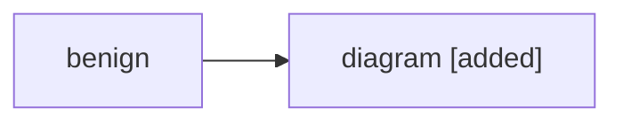
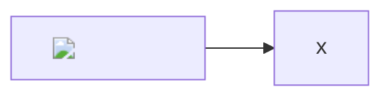

# Hostile branch report

A commit message that tries to run code: </script>

[a link](javascript:window.__xss=(window.__xss||[]).concat('link'))

<a href="javascript:window.__xss=1" onclick="window.__xss=(window.__xss||[]).concat('onclick')">anchor</a>

| Column | Value |
| --- | --- |
| a | b |

<!-- an open comment, last on purpose because marked reads it to the end of the text 
