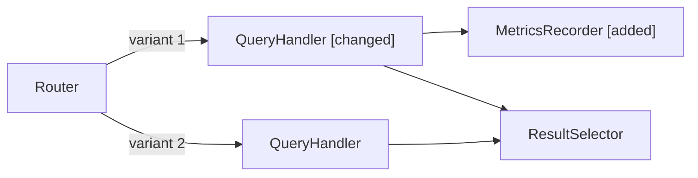
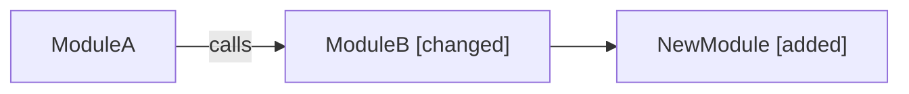
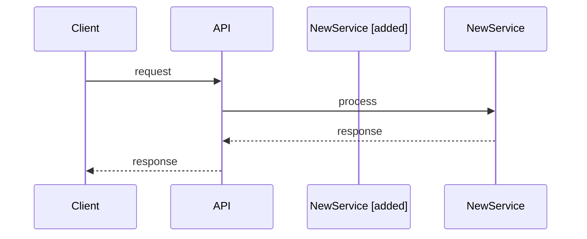
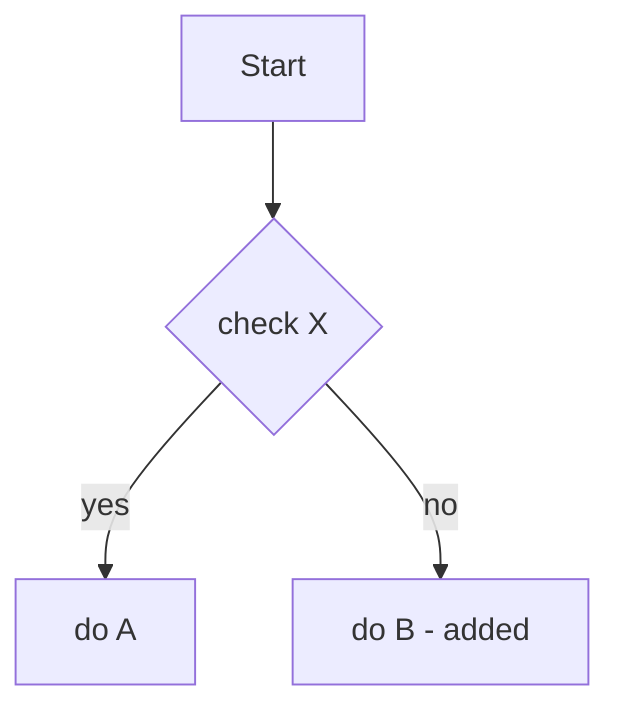
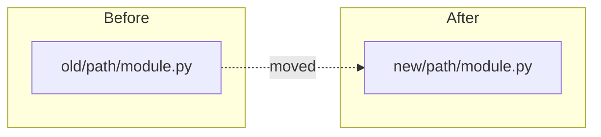

# branch-summary: report format

Read this whole file once, after the analysis in SKILL.md Sections 0-2 and before you draft any diagram or write the report (the full report or the small-change fast path). It holds what SKILL.md left out to stay small: the Mermaid rules and example (Section 3), workaround detection and the severity table (Section 4), and the output template, omission rule, output format, output destination and HTML report (Section 5). The text below moved here from SKILL.md word for word; its section numbers are the ones it had there.

`build-report.mjs` refuses a report without a `#` title, `## Summary` and `## Test Coverage` (the fast path needs only the title and its `**Branch**:` line), and names this file in its error.

---

## Section 3 -- Mermaid Diagram Generation

Generate **up to 5 diagrams** depending on what the diff touches:

| Diagram Type | When to Generate | Mermaid Type |
|---|---|---|
| Architecture | Changes touch 2+ modules or add/remove components | `flowchart` or `graph` |
| Data / Control Flow | Changes affect request handling, event flow, or pipelines | `sequenceDiagram` |
| Data Models | Changes to Pydantic models, dataclasses, ORM models, or schemas | `erDiagram` or `classDiagram` |
| Decision Paths | Changes introduce branching logic, error handling, or conditional flows | `flowchart` with branching |
| Structure Refactor | Changes are primarily file moves, renames, or restructuring with no new functionality | `flowchart` showing before/after file organization |

### Rules for diagram generation

- Only generate diagrams relevant to the actual changes (skip if not applicable).
- **Before/after annotations**: Use annotations to distinguish changes within a single diagram:
  - `[added]` suffix for new components/fields/steps.
  - `[changed]` suffix for modified components.
  - `[removed]` suffix for deleted components (shown with dashed lines if supported, otherwise annotated).
- Include enough unchanged context to make the diagram understandable (immediate neighbors of changed nodes), but do not diagram the entire system.
- Follow mermaid syntax rules: no spaces in node IDs, quote special chars in labels, no explicit styling.
- **Complexity cap**: If a diagram would have more than 8 nodes, show only the changed components and their immediate neighbors. Add a note below the diagram: "_Simplified -- showing changed components and direct connections only._"
- **No interactive features**: Do not use `click` callbacks, `tooltip`, or other interactive mermaid features that do not render in static markdown.
- **Validate syntax**: After generating each diagram, mentally verify the mermaid syntax is valid (matching brackets, valid arrow syntax, no unquoted special characters in labels). If uncertain, simplify the diagram rather than risk a syntax error.

### Example

Architecture diagram with annotations:



---

## Section 4 -- Workaround Detection

Scan only the added and modified lines in the diff (not the full file). The goal is to detect workarounds *introduced by this branch*, not pre-existing ones. If an existing workaround comment is visible in the diff context lines (unchanged), note it only if the surrounding code was meaningfully modified.

Check for:

1. **Branch name patterns**: `workaround/`, `hack/`, `hotfix/`, `temp/`, `quickfix/`.
2. **Commit message keywords**: "workaround", "temporary", "hack", "quick fix", "revert later", "TODO".
3. **Code comments**: `# HACK`, `# WORKAROUND`, `# FIXME`, `# TODO: remove`, `// TEMP`, `/* QUICK FIX */`, `# ponytail:` (see below for special handling).
4. **Structural indicators**: monkey-patching, duplicated logic to avoid touching shared code, feature flags guarding incomplete work.
5. **Disabled tests**: Scan test files for skip/disable markers: `@pytest.mark.skip`, `@pytest.mark.skipIf`, `xit(`, `xdescribe(`, `.skip()`, `@Disabled`, `@Ignore`, `@unittest.skip`. These are often workarounds that hide regressions or incomplete features.

### Ponytail markers

A `# ponytail: <ceiling>, <upgrade path>` comment (a convention for a documented shortcut) marks a *deliberate, already-approved* simplification — the author documented its ceiling and upgrade trigger at write time, so don't re-derive Why/Remove-when from scratch:

- Best-effort split the comment on the first comma: text before → **Why** (the stated ceiling/tradeoff), text after → **Remove when** (the stated upgrade path). If it doesn't split cleanly, quote the whole comment under **What** and write "see comment" for Why/Remove-when rather than force a bad split.
- Grade severity on the same High/Medium/Low scale as any other workaround (below) — being pre-approved doesn't exempt it from a risk check, it just means the Why/Remove-when are already answered by the author.

### Workaround severity classification

| Severity | Criteria | Examples |
|---|---|---|
| **High** | Security bypassed, validation skipped, hardcoded credentials, disabled auth | `# HACK: skip auth check for now`, disabled security test |
| **Medium** | Duplicated logic, monkey-patching, feature flags for incomplete work, disabled non-security tests | `# WORKAROUND: copy-paste from module X to avoid circular import` |
| **Low** | Cosmetic hacks, naming shortcuts, temporary logging, minor TODO items | `# TODO: rename this variable`, `# HACK: hardcoded page size` |

When a workaround is detected, explain:

- **Severity**: High / Medium / Low (using the table above).
- **What** the workaround is.
- **Why** it exists (root cause that made the proper fix infeasible now).
- **When** or **how** it should be removed (follow-up ticket, next sprint, etc.).

---

## Section 5 -- Output Template

### Section omission rule

Omit sections entirely if they have no meaningful content. Do not print "N/A" or "None" sections. Always include: Summary and Test Coverage. All other sections are conditional -- include only when relevant.

### Output format

**Output pure markdown only** -- no conversational text, no preamble, no "Here's the summary" or similar framing. Start directly with the markdown title (`#`).

The output must be **GitLab-compatible markdown**:
- Use standard markdown syntax (headers, lists, code blocks, tables)
- Mermaid diagrams render natively in GitLab -- use triple backtick code blocks with `mermaid` language identifier
- Use `**bold**` for emphasis, not HTML tags
- Use `-` for unordered lists (GitLab standard)
- For collapsible sections (optional), use GitLab's `<details>` tags:
  ```html
  <details>
  <summary>Click to expand</summary>
  
  Content here
  </details>
  ```

### Output destination

**Always write a self-contained HTML file to the OS temp directory.** Never write inside the repo working tree, and never print the full markdown report to chat.

Steps:

1. **Choose temp path**: run `mktemp -d` via the Bash tool to get a fresh per-invocation directory (avoids collisions with concurrent runs and keeps the workspace clean). The two files are `<that-dir>/branch-summary-<slugified-title>.md` and `<that-dir>/branch-summary-<slugified-title>.html`. Slugify the title by lowercasing, replacing non-alphanumerics with `-`, and trimming leading/trailing dashes.
2. **Write the markdown report** to the `.md` path with the Write tool, using the template below (with the section omission rules and trimmed sections already applied).
3. **Build the HTML** from it with the helper that ships next to this file: `SK=${SK:-$HOME/.claude/skills/branch-summary}; node "$SK/build-report.mjs" <report.md> <report.html>` (Node 22+). Never write the HTML yourself: the helper embeds the markdown as inert JSON data, which is what stops text from the branch from running as script. If Node is missing, stop after step 2 and print the `.md` path instead.
4. **In chat, print only**:
   - the absolute HTML path (clickable / copyable for the user),
   - the one-paragraph `## Summary` body,
   - the count of detected workarounds (e.g. "Workarounds: 2 detected (1 High, 1 Medium)") — or omit the line if none.

   Do not print the rest of the report; the user opens the HTML to read it.

### HTML report

`report-template.html` loads `marked`, `DOMPurify` and `mermaid` from jsdelivr at exact versions with `integrity` hashes, so the file is self-contained apart from those three scripts and opens directly from disk. It renders the markdown, keeps only a fixed set of tags, attributes and URL schemes, and runs mermaid in `strict` mode with SVG labels and a locked config (a diagram's `%%{init}%%` cannot turn HTML labels back on). Its Content-Security-Policy allows only the one inline script, by hash, and the CDN: no remote images, no network calls, no inline event handlers. A "Copy as Markdown" button returns the source unchanged. Do not edit the template to loosen any of this: the report text comes from commit messages, file names and comments, which the branch's author controls. To bump a library, change its version and its hash together (the command is in the template).

### Template

The template below shows the **maximum structure**. Only include a section if it has content. Conditional sections (marked with `[conditional]`) should be omitted entirely when empty -- never print them with "N/A" or "None."

**Output this markdown verbatim** -- start with `#` title, no conversational wrapper.

```markdown
# <short-brief-title-describing-the-changes>

**Branch**: `<current-branch>` | **Base**: `<base-branch>` | **Commits**: N | **Files**: N

## Summary

Brief paragraph summarizing the branch purpose and key takeaways.

## Breaking Changes  [conditional -- omit if backward-compatibility scan found nothing]

- **<signal type>** in `path/to/file.ext`: <what changed, who is affected>
- _(repeat per finding; severity ordered, breaking-API findings first)_

## Dependencies  [conditional -- omit if no manifest files changed]

- **Files**: `requirements.txt`, `package.json`, `go.mod`, etc.
- **Added**: `package-name==1.2.3` (reason if known)
- **Removed**: `old-package==0.9.0`
- **Upgraded/Downgraded**: `package-name 1.0.0 → 1.2.3`

## Configuration and Documentation  [conditional -- omit if no config/doc files changed]

- **Files**: `config.yaml`, `README.md`, etc.
- **What changed**: <concise summary>
- **Why**: <rationale>
- **Risk**: <any operational risk: new env var required, CI behavior change, etc.>

## Deployment Notes  [conditional -- omit if no env vars, migrations, infra changes, or ordering needed]

- **New environment variables**: `VAR_NAME` (usage context)
- **Database migrations**: `001_add_column.sql` (what it does)
- **Infrastructure changes**: `Dockerfile` (what changed)
- **Deployment ordering**: Deploy config before code / Run migration before deploy / etc.

## Diagrams  [conditional -- omit entirely if no diagrams apply; include only relevant sub-sections]

### Architecture



### Data / Control Flow



### Data Models

```mermaid
erDiagram
  USER ||--o{ ORDER : places
  ORDER {
    string id
    datetime created_at [added]
  }
```

### Decision Paths



### Structure Refactor



## Test Coverage

### Tests Added/Modified

- **`test_function_name`** (`path/to/test_file.py:42`): validates <implementation change>
- **`TestClassName::test_method`** (`path/to/test_file.py:80`): validates <implementation change>

### Coverage Gaps

- `module/feature.py` changes lack tests: <specific gaps>
- _OR_ **All changes covered** (if no gaps)

## Workaround Analysis  [conditional -- omit if no workarounds detected]

### 1. <Workaround Title> — **Severity: High**

- **Location**: `path/to/file.py:42`
- **What**: <description of the workaround>
- **Why**: <root cause that made the proper fix infeasible now>
- **Remove when**: <follow-up ticket ID, next sprint, specific condition>

### 2. <Workaround Title> — **Severity: Medium**

- **Location**: `path/to/file.py:100`
- **What**: <description>
- **Why**: <root cause>
- **Remove when**: <plan>
```
